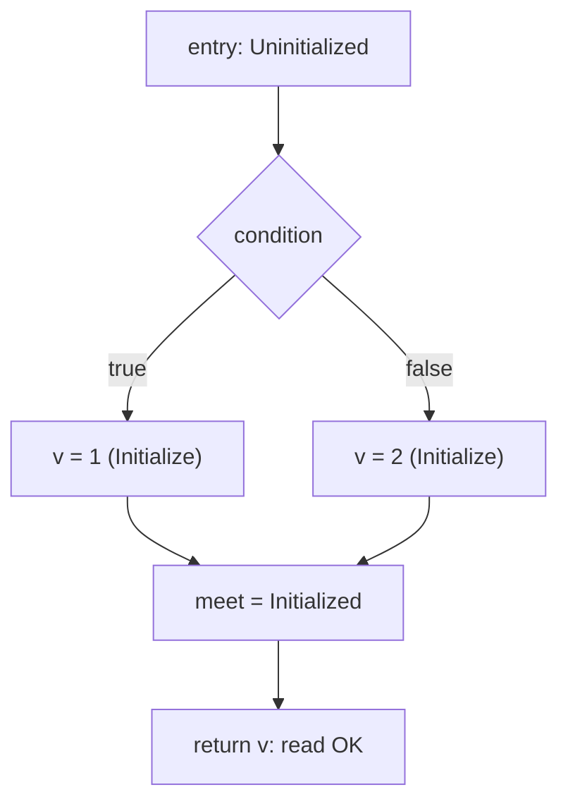

# RFC 0055: Definite Assignment For Initializer-less Local Bindings

## Summary

Promote the one-line intent already in [Chapter 6](../spec/chapters/06-declarations.md)
(`let` without an initializer is accepted only where definite assignment
proves exactly one write before the first read) into a complete, testable
contract. A local binding may omit its initializer regardless of keyword;
initialization is a property of control-flow paths. A `let` binding is
initialized at most once per reaching path (the single write may appear
textually after the declaration); a `mut` binding may be overwritten any
number of times after its first initialization. Any read not dominated by
an assignment on every reaching path remains the existing ZOM4093
rejection. This RFC specifies the dataflow, the diagnostic split, the
`Initialize`/`Overwrite` write contract across HIR and Built MIR, and the
end-to-end lowering, and lands it on the RFC 0048 recursive MIR write
family.

## Motivation

Chapter 6 already specifies the direction and shows the branch
initialization example, and Chapter 14 already specifies that reading an
uninitialized place is an error and that assignment to a complete place
reinitializes it. The production compiler does not implement the
`let`-without-initializer half:

- `mut v: i32; v = 1; return v;` passes `--check` (the ownership rail
  accepts it) but has no HIR/MIR lowering strategy, so it never reaches
  codegen.
- `let v: i32; v = 1; return v;` is rejected at the write as ZOM4099
  (capability rejection) rather than accepted as a one-shot initialization.
- `let v: i32; if (c) { v = 1; } else { v = 2; } return v;` is rejected as
  ZOM4099 inside the branch.

The one-sentence grammar comment is not enough to implement against: it
does not define the path-join model, what "exactly one write" means over
control flow, which diagnostic fires on the second write to a `let`, or
how the first write is distinguished from an overwrite in HIR/MIR. This
RFC fills that gap without changing the language direction. The user
workflow blocked is ordinary conditional initialization of an immutable
value:

```zom
let port: i32;
if (secure) { port = 443; } else { port = 80; }
listen(port);
```

Today this forces either a redundant initializer (`let port = 0;`) or
upgrading to `mut` to obtain a single write the program never performs
again, weakening the meaning of `let`.

## Goals

- Define definite assignment as a path-sensitive lattice over the
  function CFG for body-local bindings.
- Accept an initializer-less `let` binding when every path that reaches a
  read assigns it exactly once before that read; keep ZOM4093 for reads not
  so dominated.
- Classify the dominating first write to an initializer-less binding as
  `Initialize`; classify a write to an already-initialized place as
  `Overwrite`.
- Reject a second assignment to a `let` binding with the immutable-mutation
  diagnostic, without weakening `let` into "reassignable exactly once on
  purpose".
- Lower the admitted straight-line and four-block-diamond late-init shapes
  end to end through HIR and Built MIR, reusing the RFC 0048 recursive MIR
  builder's `LocalWrite`/`Assign(Initialize)` path.
- Add conformance and unit coverage for the accepted and rejected shapes.

## Non-Goals

- Partial field-by-field initialization of an aggregate from separate
  statements (`let p: Point; p.x = 1; p.y = 2;`). Such an aggregate must be
  wholly assigned in one statement; Chapter 14's initialized-prefix drop
  rules stay out of the source-language admission slice here.
- Loop-carried initialization where the place is assigned only on some
  iterations and has no assignment before the loop. Loop-header join
  handling stays at the existing reducible-CFG bound; a use not dominated on
  every path is rejected.
- Module-scope bindings. ZOM4087 (`ModuleBindingInitializerRequired`)
  remains the module-level contract.
- Constant (`const`) bindings: they still require a constant evaluator
  initializer at the declaration.
- Interior mutability behind a shared reference; this RFC is about binding
  and place assignment, not mutation through `&`.
- A general typestate system or user-visible flow-sensitive types.

## Prior Art

- **Rust definite assignment and move tracking.** Rust permits `let x: T;`
  followed by a single assignment before use, including branch
  initialization where every arm assigns once, and rejects reads of
  possibly-uninitialized variables and assignments that would violate
  borrow/move state. ZOM copies the path-sensitive "initialized on all
  reaching paths" model and the single-initialization meaning of immutable
  bindings. ZOM avoids Rust's loose historical handling of reassignment to
  immutable variables: a second write to a `let` binding is a hard
  immutable-mutation error rather than a warning, because ZOM already has a
  first-class ZOM4024 mutation diagnostic and a stricter diagnostic
  posture.
  <https://doc.rust-lang.org/book/ch03-01-variables-and-mutability.html>
- **Java/Kotlin/C# definite assignment.** JVM-family languages use a
  flow-sensitive "definitely assigned" analysis over blank `final`/`val`
  variables: an unassigned `final` may be assigned once on every path
  before use, and a second assignment is an error. This confirms the
  branch-join semantics (intersection at joins, assignment on all paths
  required) are mature and implementable. ZOM copies the "blank final"
  single-assignment-per-path rule.
- **Swift `let` with deferred initialization.** Swift allows a `let`
  constant to be initialized after declaration as long as it is initialized
  exactly once on every path and only read afterward. This validates the
  keyword ergonomics ZOM already chose (`let` = one initialization, not
  "initializer token at the declaration").
- **Chapter 14 reinitialization rule.** ZOM already specifies that a move
  leaves a place uninitialized "until it is assigned a new value" and that
  complete-place assignment reinitializes it. This RFC reuses that
  move/reinit lattice rather than inventing a parallel state machine.

## Guide-Level Explanation

A binding can be declared without a value when the type is annotated:

```zom
fn port_for(secure: bool) -> i32 {
  let port: i32;
  if (secure) {
    port = 443;
  } else {
    port = 80;
  }
  return port;
}
```

`let port` is immutable, yet the program assigns it once per branch before
the read. The compiler verifies two things: (1) no matter which branch ran,
`port` has a value by the time `return port;` executes, and (2) no branch
assigns it twice. Both hold, so this compiles.

The same rules reject the obvious mistakes:

```zom
let a: i32;
return a;            // error: a might be uninitialized here

let b: i32;
if (c) { b = 1; }
return b;            // error: b is uninitialized on the else path

let d: i32;
d = 1;
d = 2;               // error: cannot mutate immutable binding d

mut e: i32;
return e;            // error: e might be uninitialized here (mut does not
                     //        relax the initialized-before-use rule)

mut f: i32;
f = 1;
f = 2;               // OK: mut may be overwritten
return f;
```

The mental model: `let` means "this name holds one value, assigned once",
wherever on the path that single assignment happens; `mut` means "this name
holds a value that can be replaced". Neither keyword grants permission to
read a place that has no value yet.

## Reference-Level Design

### Lattice and transfer

Definite assignment is computed over the function's reducible CFG for each
body-local binding. The per-binding state is a two-level lattice:

```
        Uninitialized (bottom)
              |
        Initialized (top)
```

- Entry state: `Uninitialized` for an initializer-less binding; bindings
  with a declared initializer enter as `Initialized` after their
  `Initialize` statement.
- Statement transfer:
  - `Initialize` write to the place: out-state `Initialized`.
  - `Overwrite` write: requires in-state `Initialized`; out-state
    `Initialized`. An `Overwrite` targeting an `Uninitialized` place is a
    compiler-contract failure (the write should have been classified
    `Initialize`), not a user diagnostic.
  - read / move / borrow / drop: requires in-state `Initialized`, otherwise
    ZOM4093 with a ZOM4094 note at the binding.
- Branch: the discriminant read follows the read rule; successor edges
  inherit the current state.
- Join block: state is the meet (intersection) of predecessor states.
  `Initialized` at the join only if every predecessor reaches it
  `Initialized`.



A read is legal exactly when its in-state is `Initialized`. This subsumes
straight-line and four-block-diamond shapes on the admitted CFG slice.

### Single-assignment rule for `let`

The frontend records a per-path write count for `let` bindings in addition
to the init lattice:

- The first dominating assignment to an initializer-less `let` place is an
  `Initialize` and is permitted.
- Any later assignment to that `let` place on a path where it is already
  initialized is an immutable-mutation error. It drains through the existing
  ZOM4024 channel (`CannotMutateImmutableVariable`,
  Body/Mutation/InvalidOperation, Identifier display argument) naming the
  binding. No new diagnostic is introduced.
- An assignment to a `let` place on a path where it is still uninitialized
  is the single `Initialize`, not an error, even inside one arm of a branch,
  provided the join-before-read and one-write-per-path constraints hold.
- For the admitted slice this is enforced by linear and diamond structural
  checks; a general path-count dataflow is explicitly out of scope and the
  more complex shapes stay rejected by the admission gate.

`mut` bindings have no write-count restriction; every post-initialization
write is an `Overwrite`, the first write is an `Initialize`.

### Write classification in the body checker

The body checker decides `Initialize` vs `Overwrite` for a scalar local
write (`BodyProductionKind::LocalWrite`) using the same init lattice it
uses to reject uninitialized reads:

- target binding is initializer-less and the write is the first to reach it
  on the in-state: admit and mark `Initialize`.
- target is already initialized: an `Overwrite`, admitted only for `mut`
  (and for a `let` this is the ZOM4024 drain above).

`isSimpleLocalWrite`
(`compiler/checker/body/body-checker.cc`) is extended so a write to an
initializer-less owner local is admitted when the lattice says it is the
first write; the unconditional `isMutableOwnerLocal` gate is replaced by
the (first write allowed for `let`) or (already initialized and owner is
`mut`) predicate. The emitted `CheckedPlaceFact` / write production carries
enough information for HIR to choose `HirLocalWriteKind::Initialize` versus
`Overwrite`. Existing initialized-binding behavior is unchanged.

### HIR contract

`HirLocalWriteKind` already exists
(`compiler/hir/hir-module.h`): `Initialize = 0x01`, `Overwrite = 0x02`. No
new IR node is required.

- The HIR shape classifier gains an initializer-less binding plus one later
  `Initialize` write shape: a `HirLocalBinding` whose `initializer` is
  `none`, followed by a `HirLocalWriteStatement` of kind `Initialize` to
  that `local`, followed by a trailing local reference (and the analogous
  diamond for branch initialization).
- The current `ScalarLocalOverwrite` arm keeps requiring an initializer and
  stays the shape for `mut x = <init>; x = ...;`. The late-init shape is a
  distinct arm (no initializer node; the write supplies initialization).
- The GenericShape catch-all must not be extended to paper over this; a
  dedicated arm is added under the RFC 0048 family decomposition.

### Built MIR contract

For an initializer-less binding the recursive MIR builder (RFC 0048
Phase 3 write family) emits, in order:

1. parameter/user local declaration,
2. `StorageLive` for the place (place starts uninitialized),
3. on the single initializing write: `Assign` with
   `MirInitializationKind::Initialize`,
4. for a later `mut` write: `Assign` with `MirInitializationKind::Overwrite`
   (requires the place already initialized),
5. the trailing read as a copy/move operand, gated on the initialized state.

For the four-block diamond, each arm ends by assigning its target before
the join block reads it; no block parameters or PHIs are introduced (MIR
stays place-based). The structural verifier confirms an `Overwrite` never
targets a place that lacks a dominating `StorageLive`+`Initialize`, and the
ownership rail confirms the join read is initialized on both edges.

No change to the `MirStatement`/`MirRvalue` vocabulary or the canonical MIR
codec is required; only construction and verification of the already
existing `Initialize`/`Overwrite` kinds is extended.

### Diagnostics

| Condition | Diagnostic |
|---|---|
| Read of a place uninitialized on some reaching path (`let` or `mut`) | ZOM4093 `UninitializedPlaceUse` + ZOM4094 note at the binding |
| Second assignment to an initialized `let` place | ZOM4024 `CannotMutateImmutableVariable` naming the binding |
| Construct the slice cannot lower yet (non-admitted shape) | unchanged ZOM4099 capability rejection, fail-closed |
| Module-scope initializer-less binding | unchanged ZOM4087 |

### Acceptance boundary

Initially the admitted end-to-end shapes are:

- straight-line `mut v: T; v = <literal/param>; return v;`,
- straight-line `let v: T; v = <literal/param>; return v;`,
- four-block diamond `let v: T; if (c) { v = a; } else { v = b; } return v;`
  with scalar leaves.

Anything outside this boundary (loops, aggregate partial init, multiple
writes before the read on the `let` path) keeps the current fail-closed
behavior until a later vertical slice extends the lattice and lowering.

## Repository Impact

| Area | Paths | Owner |
|---|---|---|
| Specification | `docs/spec/chapters/06-declarations.md` (expand the definite-assignment comment into normative prose), `docs/spec/chapters/14-memory-management.md` (cross-reference the path rule) | `spec-audit` |
| Body checker | `compiler/checker/body/body-checker.cc` (LocalWrite admission, Initialize/Overwrite classification, ZOM4024 drain for second `let` write) | `binder-checker` |
| Diagnostics contracts | `compiler/diagnostics/defs/diagnostics-checker.def`, `compiler/checker/inference/checked-facts.cc` projector/stage mapping (reuse ZOM4024/ZOM4093) | `error-system` |
| HIR builder | `compiler/hir/build/hir-pending.h`, `hir-shape.cc`, `hir-builder.cc`, new late-init arm under `build/` | `ir-backend` |
| Built MIR | `compiler/mir/build/recursive-mir-builder.*`, `mir-builder.cc`, structural verifier | `ir-backend` |
| Conformance | `tests/conformance/corpus/05-statements/**`, grammar + AST + diagnostics expectations | `verification` |
| Unit tests | body checker / HIR / MIR builder ztests | `verification` |
| Design note | `docs/design/language/definite-assignment.md` (mark implemented when landed) | `rfc` |

## Security And Safety Impact

Positive safety impact, no new unsafe surface. The change tightens and makes
explicit a memory-safety invariant: no place is read, moved, borrowed, or
dropped before it is initialized on every reaching path. Implementing the
analysis wrong would risk codegen touching uninitialized stack slots, which
is why acceptance is gated on both the structural MIR verifier
(`Overwrite` requires a dominating initialization) and the ownership rail
(ZOM4093) rather than on one layer. No raw pointer, FFI, concurrency, or
sandbox boundary changes.

## Drawbacks And Risks

- **Dataflow soundness.** A lattice that accepts a read not actually
  initialized on some path would be unsound. Mitigation: restrict the
  admitted slice to straight-line and four-block diamonds where dominance
  is structural and independently checked by HIR, MIR verifier, and
  ownership rail; keep loops and partial init out.
- **Keyword meaning drift.** Treating a textual late write to `let` as legal
  could blur `let`/`mut`. Mitigation: the rule stays "at most one
  assignment per path" and a second write is ZOM4024; the guide-level docs
  frame `let` as one initialization, not a declaration-site token.
- **Phase 3 coupling.** End-to-end lowering depends on the RFC 0048
  recursive MIR write family. The checker/HIR acceptance can land first,
  but shapes the MIR builder cannot yet lower must continue to fail closed
  at ZOM4099 rather than crash; the coupling in RFC 0048 (publish a fact
  only when the builder can consume it) is respected.
- **Regression risk on existing initialized shapes.** The admission
  predicate changes. Mitigation: corpus process + IR parity gates and
  targeted ztests.

## Alternatives Considered

- **Reject every initializer-less `let` at the declaration, require `mut`
  for late init.** Simpler checker, but it loses branch one-shot immutable
  initialization and forces repeated-mutation permission for a single
  write, weakening `let`. The Chapter 6 grammar already promises the more
  precise behavior, so this would be a spec regression. Rejected.
- **Allow `let` late init without a write-count rule (rely only on the
  uninitialized-read check).** This would silently permit a second
  assignment to a `let`, making `let` and `mut` differ only in error text.
  Rejected; the explicit single-assignment ZOM4024 rule preserves the
  keyword distinction.
- **Full general typestate / partial aggregate initialization now.** More
  expressive, but it requires field-level lattices, initialized-prefix
  drops, and loop-header joins across the whole CFG — a much larger surface
  that touches Chapter 14 deeply. Rejected for this RFC and listed as a
  non-goal to be pursued separately with its own owner review.
- **Introduce a new diagnostic for double-init.** Unnecessary; ZOM4024
  already names immutable mutation and its projector/stage contract is in
  place. Adding a parallel code would split one user concept. Rejected.

## Compatibility And Rollout

There is no working production behavior to preserve for the accepted
shapes: they currently fail with ZOM4099 (the `let` forms) or lack lowering
(the `mut` form). Rollout is therefore additive and behavior-sharpening:

1. Checker: extend `LocalWrite` admission and classify
   `Initialize`/`Overwrite`; add the second-`let`-write ZOM4024 drain.
2. HIR: add the dedicated late-init arm; leave GenericShape unchanged.
3. MIR: implement the write family in the recursive builder behind the
   Phase 3 fallback; the strategy table stays for shapes not yet migrated.
4. Spec: expand the Chapter 6 comment into normative prose and link
   Chapter 14.
5. Tests + parity: regenerate conformance snapshots for the newly accepted
   files; existing rejected files keep ZOM4093/ZOM4024.

Rollback is a single revert per stage; no serialized artifact or codec
format changes, so no data migration is possible. The corpus parity tool
(`scripts/check-ir-parity.py`) gates each stage.

## Documentation And Teaching Plan

- Replace the Chapter 6 EBNF inline comment with a "Definite Assignment"
  subsection stating the lattice informatively, the `let` one-write-per-path
  rule, and the branch example; cross-reference Chapter 14's uninitialized
  read and reinitialization rules.
- Update `docs/design/language/definite-assignment.md` from
  "specified, not fully implemented" to implemented with the landed commit
  range.
- Add conformance examples under `tests/conformance/corpus/05-statements/`
  covering the two positive and four negative shapes.
- Release note: initializer-less `let` with a single provable assignment is
  now accepted; no syntax change.

## Operational Readiness

None. No runtime, CLI, CI gate, release, observability, or performance
surface beyond the existing sanitizer build and corpus parity gate. The
analysis is local to a function body on an already-bounded reducible CFG;
compile-time cost is linear in statements.

## Acceptance Criteria

- Chapter 6 states the definite-assignment dataflow and one-write-per-path
  rule normatively (not only as a grammar comment), with `check-rfc.py` and
  the spec-alignment gate passing.
- `let v: i32; v = 1; return v;` and the `if/else` branch form compile
  end to end on the admitted shapes; the `mut` straight-line form lowers
  end to end.
- `mut v: i32; return v;` and the one-branch-missing `let` form produce
  ZOM4093 + ZOM4094; a second write to `let` produces ZOM4024.
- The first late write is HIR `Initialize` and MIR
  `MirInitializationKind::Initialize`; a later `mut` write is `Overwrite`;
  the structural MIR verifier rejects a dominating-init-less `Overwrite`
  in a mutation test.
- Corpus process and IR parity pass; new conformance grammar/AST/
  diagnostics expectations are present and green.
- All required owners approve and the tracker records the decision and
  implementation.

## Implementation Plan

1. Spec: expand Chapter 6 definite-assignment text; add Chapter 14
   cross-reference; run spec-alignment.
2. Body checker: add the init lattice to `LocalWrite` admission; classify
   `Initialize` vs `Overwrite`; drain the second `let` write to ZOM4024;
   add body-checker ztests.
3. HIR: add the late-init shape and a dedicated recursive arm; assert the
   write kind in the HIR verifier.
4. MIR: implement the write family in the RFC 0048 recursive builder
   (`StorageLive` + `Assign(Initialize)`, then `Overwrite`), including the
   four-block diamond, behind the existing fallback; extend the structural
   verifier.
5. Conformance: add positive/negative corpus files with grammar, AST, and
   diagnostics expectations.
6. Verify: sanitizer build, ztests, lit suite, native-run spot checks,
   corpus process + IR parity; then update the design note and tracker.

## Test Plan

- Build: `cmake --preset sanitizer && cmake --build --preset sanitizer`.
- Unit tests: body-checker ztests for the init lattice
  (straight-line accept, join accept, missing-branch ZOM4093, second-`let`
  ZOM4024, `mut` overwrite); HIR arm test asserting `Initialize`/
  `Overwrite`; MIR builder/verifier mutation test rejecting an `Overwrite`
  with no dominating initialization.
- Lit tests: new `05-statements` conformance cases for
  `let_*_definite_assignment_pos_*` (straight-line, branch) and
  `*_neg_*` (uninit read for `let` and `mut`, missing branch, double let
  write), with grammar YAML, AST, and CHECK-LITERAL diagnostics.
- Conformance: `ctest --preset default -L lit`; the ZOM4024 and ZOM4093
  suites remain green.
- Native: a positive branch-init program compiled and run to its expected
  exit value through `zomc run`.
- Generated files: regenerate affected AST snapshots via `regen-lit.py`;
  record a fresh corpus parity snapshot that includes the new sources.
- Format: `python3 scripts/check-format.py`.

## Open Questions

None. The non-goals explicitly defer loop-carried and partial-aggregate
initialization; if those are pursued they get a separate RFC with expanded
Chapter 14 coverage.

## Status History

| Date | Status | Notes |
|---|---|---|
| 2026-10-17 | DRAFT | Initial draft specifying definite assignment for initializer-less local bindings. |
| 2026-10-17 | REVIEW | Opened for owner review: rfc, spec-audit, binder-checker, ir-backend, error-system, verification. |
