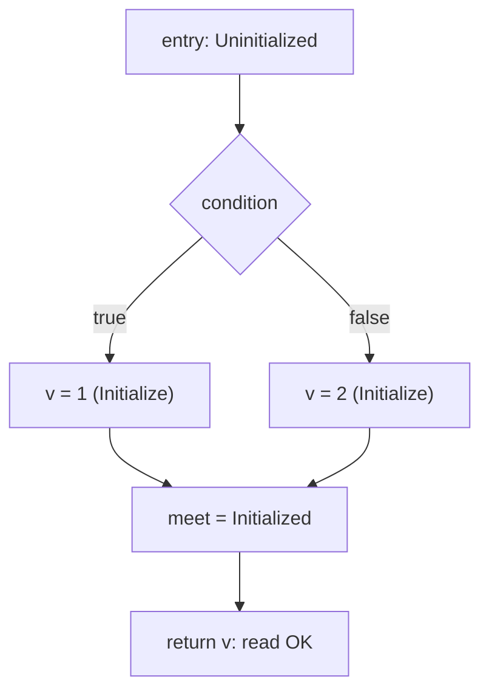

# RFC 0055: Definite Assignment For Initializer-less Local Bindings

## Summary

Promote the one-line intent already in [Chapter 6](../spec/chapters/06-declarations.md)
(`let` without an initializer is accepted only where definite assignment
proves exactly one write before the first read) into a complete, testable
contract. A local binding may omit its initializer regardless of keyword;
initialization is a property of control-flow paths. A `let` binding is
initialized at most once per reaching path (the single write may appear
textually after the declaration); a `mut` binding may be overwritten any
number of times after its first initialization. Any read not dominated by
an assignment on every reaching path remains the existing ZOM4093
rejection. This RFC specifies the dataflow, the diagnostic split, the
`Initialize`/`Overwrite` write contract across HIR and Built MIR, and the
end-to-end lowering, and lands it on the RFC 0048 recursive MIR write
family.

## Motivation

Chapter 6 already specifies the direction and shows the branch
initialization example, and Chapter 14 already specifies that reading an
uninitialized place is an error and that assignment to a complete place
reinitializes it. Current production behavior (verified against the
sanitizer build) is uneven:

- `mut v: i32; v = 1; return v;` works end to end today. It passes
  `--check`, lowers through the HIR `GenericShape` catch-all plus the MIR
  generic materializer, and `zomc run` exits with the assigned value.
  `mut f: i32; f = 1; f = 41; return f;` also passes `--check` and exits
  41. These shapes must be protected by corpus parity, not treated as new.
- `let v: i32; v = 1; return v;` is rejected at the write as ZOM4099
  (capability rejection) rather than accepted as a one-shot initialization.
- `let v: i32; if (c) { v = 1; } else { v = 2; } return v;` is rejected as
  ZOM4099 inside the branch.
- Two related ICEs are current baselines the implementation must clear: a
  parameter-RHS late init (`mut v: i32; v = p; return v;`) and some
  initialize-then-overwrite paths hit an `ir`-phase internal compiler error
  on admitted shapes. They must become working end-to-end paths or a clean
  diagnostic, with lit tests asserting no incident.

The one-sentence grammar comment is not enough to implement against: it
does not define the path-join model, what "exactly one write" means over
control flow, which diagnostic fires on the second write to a `let`, or
how the first write is distinguished from an overwrite in HIR/MIR. This
RFC fills that gap without changing the language direction. The user
workflow blocked is ordinary conditional initialization of an immutable
value:

```zom
let port: i32;
if (secure) { port = 443; } else { port = 80; }
listen(port);
```

Today this forces either a redundant initializer (`let port = 0;`) or
upgrading to `mut` to obtain a single write the program never performs
again, weakening the meaning of `let`.

## Goals

- Define definite assignment as a path-sensitive lattice over the
  function CFG for body-local bindings.
- Accept an initializer-less `let` binding when every path that reaches a
  read assigns it exactly once before that read; keep ZOM4093 for reads not
  so dominated.
- Classify the dominating first write to an initializer-less binding as
  `Initialize`; classify a write to an already-initialized place as
  `Overwrite`.
- Reject a second assignment to a `let` binding with the immutable-mutation
  diagnostic, without weakening `let` into "reassignable exactly once on
  purpose".
- Lower the admitted straight-line and four-block-diamond late-init shapes
  end to end through HIR and Built MIR, reusing the RFC 0048 recursive MIR
  builder's `LocalWrite`/`Assign(Initialize)` path.
- Add conformance and unit coverage for the accepted and rejected shapes.

## Non-Goals

- Partial field-by-field initialization of an aggregate from separate
  statements (`let p: Point; p.x = 1; p.y = 2;`). Such an aggregate must be
  wholly assigned in one statement; Chapter 14's initialized-prefix drop
  rules stay out of the source-language admission slice here.
- Loop-carried initialization where the place is assigned only on some
  iterations and has no assignment before the loop. Loop-header join
  handling stays at the existing reducible-CFG bound; a use not dominated on
  every path is rejected.
- Module-scope bindings. ZOM4087 (`ModuleBindingInitializerRequired`)
  remains the module-level contract.
- Constant (`const`) bindings: they still require a constant evaluator
  initializer at the declaration.
- Interior mutability behind a shared reference; this RFC is about binding
  and place assignment, not mutation through `&`.
- A general typestate system or user-visible flow-sensitive types.

## Prior Art

- **Rust definite assignment and move tracking.** Rust permits `let x: T;`
  followed by a single assignment before use, including branch
  initialization where every arm assigns once, and rejects reads of
  possibly-uninitialized variables and assignments that would violate
  borrow/move state. ZOM copies the path-sensitive "initialized on all
  reaching paths" model and the single-initialization meaning of immutable
  bindings. ZOM avoids Rust's loose historical handling of reassignment to
  immutable variables: a second write to a `let` binding is a hard
  immutable-mutation error rather than a warning, because ZOM already has a
  first-class ZOM4024 mutation diagnostic and a stricter diagnostic
  posture.
  <https://doc.rust-lang.org/book/ch03-01-variables-and-mutability.html>
- **Java/Kotlin/C# definite assignment.** JVM-family languages use a
  flow-sensitive "definitely assigned" analysis over blank `final`/`val`
  variables: an unassigned `final` may be assigned once on every path
  before use, and a second assignment is an error. This confirms the
  branch-join semantics (intersection at joins, assignment on all paths
  required) are mature and implementable. ZOM copies the "blank final"
  single-assignment-per-path rule.
- **Swift `let` with deferred initialization.** Swift allows a `let`
  constant to be initialized after declaration as long as it is initialized
  exactly once on every path and only read afterward. This validates the
  keyword ergonomics ZOM already chose (`let` = one initialization, not
  "initializer token at the declaration").
- **Chapter 14 reinitialization rule.** ZOM already specifies that a move
  leaves a place uninitialized "until it is assigned a new value" and that
  complete-place assignment reinitializes it. This RFC reuses that
  move/reinit lattice rather than inventing a parallel state machine.

## Guide-Level Explanation

A binding can be declared without a value when the type is annotated:

```zom
fn port_for(secure: bool) -> i32 {
  let port: i32;
  if (secure) {
    port = 443;
  } else {
    port = 80;
  }
  return port;
}
```

`let port` is immutable, yet the program assigns it once per branch before
the read. The compiler verifies two things: (1) no matter which branch ran,
`port` has a value by the time `return port;` executes, and (2) no branch
assigns it twice. Both hold, so this compiles.

The same rules reject the obvious mistakes:

```zom
let a: i32;
return a;            // error: a might be uninitialized here

let b: i32;
if (c) { b = 1; }
return b;            // error: b is uninitialized on the else path

let d: i32;
d = 1;
d = 2;               // error: cannot mutate immutable binding d

mut e: i32;
return e;            // error: e might be uninitialized here (mut does not
                     //        relax the initialized-before-use rule)

mut f: i32;
f = 1;
f = 2;               // OK: mut may be overwritten
return f;
```

The mental model: `let` means "this name holds one value, assigned once",
wherever on the path that single assignment happens; `mut` means "this name
holds a value that can be replaced". Neither keyword grants permission to
read a place that has no value yet.

## Reference-Level Design

### Two analyses, two layers

Definite assignment is enforced at two independent layers. They must not
be conflated.

1. **Body-checker admission analysis (new).** A new, AST-structural,
   function-local pre-pass over the body checker's production sites
   decides, for each scalar owner-local write, whether it is the binding's
   first write (`Initialize`) or a later one (`Overwrite`), and whether the
   binding is mutable. This is structural over the admitted reducible
   shapes (straight line plus the four-block diamond), not a general
   dataflow engine. It does not exist today: `CheckedPlaceFact` carries
   only `node/root/projections/type/mutablePlace/movable` and `LocalWrite`
   emits no place fact. The body checker has no init-state tracking and no
   ZOM4093 emitter, and this RFC adds neither to it.
2. **Ownership MIR rail (existing, unchanged producer).** After HIR and
   Built MIR exist, `compiler/ownership/facts/init.cc` runs the real
   path-sensitive lattice keyed on `MirPoint`/`MovePathKey`
   (`InitializationState { storageLive, mayBeInitialized, mustBeInitialized }`
   with intersection joins) and is the sole producer of ZOM4093/ ZOM4094.
   It is the defense-in-depth verifier that a read the structural admission
   analysis lets through is actually initialized on every reaching path.

The ownership lattice is two-level per binding:

```
        Uninitialized (bottom)
              |
        Initialized (top)
```

- Entry state: `Uninitialized` for an initializer-less binding; a binding
  with a declared initializer is `Initialized` after its `Initialize`.
- An `Initialize` moves out-state to `Initialized`; an `Overwrite` requires
  in-state `Initialized`.
- A read/move/borrow/drop requires `Initialized` on every reaching path;
  at a join the state is the intersection of predecessors.

ZOM4093/ZOM4094 therefore remain ownership-rail-only. The single producer
is `compiler/ownership/facts/init.cc` (`InitializationLossKind::
NeverInitialized`/`Moved`), projected by the ownership projector
(`CheckerErrorId` has no `UninitializedPlaceUse` and there is no checker
projector/stage entry for it). Because the rail runs only on shapes that
build HIR and MIR, the HIR/MIR builders must construct the
error-preserving shape for a rejected read - the existing
`UninitializedLocalReturn` arm does this for the straight-line case, and
this RFC extends that construction to the one-branch-missing diamond and
the uninitialized-`mut` shapes. A checker-side ZOM4093 is explicitly
rejected: it would require a new typed issue, a zero-argument
`validArgumentSchema` entry, a new `validDiagnosticProduction`
(stage/producer/recovery) mapping, and a checker-side ZOM4094 note channel,
plus dedup against the rail's own ZOM4093. None exists.



### Single-assignment rule for `let`

The body-checker admission analysis records, per binding and per admitted
path, whether the binding has already been written:

- The first dominating plain assignment to an initializer-less `let` place
  is an `Initialize` and is permitted.
- A later assignment to that `let` place on a path where it is already
  initialized is an immutable-mutation error. It drains through the existing
  ZOM4024 channel (`CannotMutateImmutableVariable`,
  Body/Mutation/InvalidOperation, Identifier display argument) naming the
  binding. No new diagnostic is introduced.
- An assignment to a `let` place on a path where it is still uninitialized
  is the single `Initialize`, including one assignment in each arm of a
  diamond, provided the join-before-read and one-write-per-path constraints
  hold.
- For the admitted slice this is enforced by the structural pre-pass (a
  straight-line seen-set plus a bounded diamond check). General path-count
  dataflow is out of scope and other shapes stay fail-closed.

`mut` bindings have no write-count restriction; the first write is an
`Initialize` and every later write is an `Overwrite`.

### Admission bounds: no read of the target before its Initialize

Widening admission is sound only if the initializing write cannot itself
read the uninitialized target. `isSimpleLocalWrite`
(`compiler/checker/body/body-checker.cc`) already admits compound
assignments and reference/binary RHS forms, so an unconditional
"first write is allowed for `let`" predicate would wrongly classify
`let v: i32; v = v;`, `let v: i32; v = v + 1;`, and `let v: i32; v += 1;`
as initializations even though evaluating the write reads the uninitialized
slot (the post-MIR rail never sees a shape that fails to build MIR, so
there is no downstream safety net). The first-write exception is therefore
restricted to:

- a plain assignment only: `writeOp == ast::AssignmentOperatorKind::Assign`;
  compound writes are excluded (they read the target and stay
  mut-plus-already-initialized-only),
- a RHS in the admitted value set - a Copy scalar (the admitted integer and
  boolean primitive types the existing scalar lowering path handles; no
  aggregates, references, pointers, or other non-Copy values, so a non-Copy
  parameter RHS cannot enter the `Initialize` arm), a scalar literal, a
  parameter, or an earlier already-initialized local - that does **not**
  reference the target binding in any operand,
- the lattice read rule applied to every RHS operand and to the `if`
  discriminant, not only the trailing return read.

Prefix/postfix `++`/`--` stay mut-plus-initialized-only via their existing
gate (`body-checker.cc`); they read and write the target and are not an
initialization. The diamond arms are bounded structurally: each arm is
exactly one plain assignment to the binding with no early return/break or
nested branch, and the condition does not reference the binding.

### Write-classification state seam

Today the checker does not communicate write kind; HIR derives it
(`hir-builder.cc`, from `shape.localInitializer == none` plus a flat
function-wide `writeIndex`), and the HIR verifier re-derives it at several
enumeration sites. That flat enumeration labels the second textual write
`Overwrite`, which is wrong for a diamond whose two arms are each a
per-path first write. This RFC:

- adds a dedicated checker pre-pass that builds, for each binding, a write
  registry over `productionSiteValues`: a straight-line seen-set plus the
  bounded diamond classification. It is consulted both at admission and in
  the post-write validation loop in `body-checker.cc`, instead of embedding
  state in the pure `isSimpleLocalWrite` predicate (called from the literal
  type-hint and site-classification sites);
- keeps the write kind HIR-derived (the current architecture): the builder
  and every HIR verifier enumeration site are updated in lockstep to use
  path-scoped classification, so both diamond arm writes are `Initialize`.
  No new checked-fact record or codec field is introduced; the kind is a
  property of the binding's path position, which HIR already knows. A named
  checked-fact record is an alternative that is rejected for this RFC.
- existing MIR strategy checks that hard-require `Overwrite` for update
  writes are writes to already-initialized places and are unaffected; the
  new branch `Initialize` is confined to the new arm.
- `isSimpleOwnerLocalFieldWrite` is left untouched so partial aggregate
  initialization (`let p: Point; p.x = 1;`) keeps failing (non-goal).

### HIR contract

`HirLocalWriteKind` already exists
(`compiler/hir/hir-module.h`): `Initialize = 0x01`, `Overwrite = 0x02`. The
straight-line late-init shape needs no new node. The diamond does: HIR has
no statement-level conditional - `HirConditionalExpression` is an
expression whose arms name yielded values and is only consumed by returns
and ternary initializers, so `if (c) { v = a; } else { v = b; }` (arms are
statements writing a place, not expressions yielding a value) has no
constructible HIR representation today.

- **Straight line (no new node).** The shape classifier gains an
  initializer-less binding plus one later `Initialize` write: a
  `HirLocalBinding` whose `initializer` is `none`, followed by a
  `HirLocalWriteStatement` of kind `Initialize` to that `local`, followed by
  a trailing local reference. The MIR-side write arm is `LocalWriteReturn`
  (the correct HIR/MIR build-arm name; no HIR shape or MIR build arm is
  called `ScalarLocalOverwrite` - that spelling exists only as the LIR
  helper `lowerScalarLocalOverwriteReturn` in `compiler/lir/mir-to-lir.h`),
  whose current initializer-required guard is relaxed for this arm.
- **Diamond (one new HIR node).** Add a dedicated block-level record,
  `HirConditionalLocalWriteStatement { condition, thenWrite, elseWrite }`,
  block-listed like `HirLoopStatement`, with its own pool accessor, a new
  `HirNodeKind::ConditionalLocalWrite`, fixed-id digest coverage, and a
  per-node verifier arm. `thenWrite`/`elseWrite` name the per-arm
  `HirLocalWriteStatement` nodes, each classified `Initialize` for an
  initializer-less target (the same arm serves `let` and `mut` diamonds: a
  per-path first write is `Initialize`). Scalar-leaf guards require
  `write.field == zc::none` and the admitted condition operand forms (the
  current LIR diamond matcher admits a bare bool parameter; other
  discriminant forms stay fail-closed). Reusing `HirConditionalExpression`
  as a statement is the rejected alternative: its arm-id/pool/node-id/block
  layout is value-yield oriented and would overload one record with two
  semantics.
- The `GenericShape` catch-all currently builds the working straight-line
  `mut` shapes end to end. It must not be extended to paper over the new
  `let`/diamond shapes; those get dedicated arms under the RFC 0048 family
  decomposition. The currently-working `mut` shapes are migrated off the
  legacy rail once the new arms prove byte-parity, then the legacy arms are
  deleted (parallel MIR rails are themselves a blocker); corpus parity
  gates each move. Existing field-level late-init MIR arms
  (`buildLocalFieldProjectionReturn` and the inline field arms) are
  unaffected - the new scalar arms must not duplicate or perturb them.

So the precise vocabulary delta is: **MIR vocabulary and codec unchanged;
HIR gains one statement node, its pool, digest/verifier arm, and
`HirNodeKind`.**


### Built MIR contract

For an initializer-less binding the recursive MIR builder (RFC 0048
Phase 3 write family) emits, in order:

1. parameter/user local declaration,
2. `StorageLive` for the place (place starts uninitialized),
3. on the single initializing write: `Assign` with
   `MirInitializationKind::Initialize`,
4. for a later `mut` write: `Assign` with `MirInitializationKind::Overwrite`
   (requires the place already initialized),
5. the trailing read as a copy/move operand, gated on the initialized state.

For the four-block diamond, each arm ends by assigning its target before
the join block reads it; no block parameters or PHIs are introduced (MIR
stays place-based).

The structural MIR verifier must grow from its current linear scan into a
forward per-block initialized lattice. `validateStructuralWellFormedness`
(`compiler/mir/built-mir.cc`) today keeps one bool per local in linear
block order and never inspects `MirInitializationKind`; that scan cannot
validate a diamond because an `Initialize` in a single arm flips the global
bit before the join and would accept a missing-arm `Overwrite`. The new
check computes, per block, an entry and exit initialized set:

- parameters are initialized at the entry block;
- `Initialize` requires the target uninitialized on entry and sets it;
- `Overwrite` requires the target initialized on entry;
- a block entry is the meet (AND) over its predecessors' exit sets, using
  the existing terminator traversal and `resolveDiamondCfg`.

The lattice deliberately does **not** make a read/move/borrow/`Return`
operand at a false entry a structural rejection. Reading a
storage-live-but-uninitialized place is the error-preserving carrier the
ownership rail consumes to emit ZOM4093: the existing
`UninitializedLocalReturn` path and the new one-branch-missing diamond
both build MIR containing exactly such a read, pass structural
verification, and must surface as `SourceRejected` ZOM4093/ZOM4094, never
`IrInvariantRejected`. Structural verification owns IR kind discipline
(an `Overwrite` with no dominating `Initialize`, or an `Initialize` on an
already-initialized path, is malformed MIR); the ownership rail owns
source-level uninitialized reads. Concretely, a one-arm
`Initialize` diamond is structurally valid and reaches ownership as
ZOM4093; mutating that arm's `Initialize` to `Overwrite` makes its entry
state false and is an IR-invariant rejection.

This is a bounded structural lattice over the admitted reducible CFG, not a
general dominator pass. The RFC 0007 ownership overlay is fail-closed and
publishes no `VerifiedOwnershipFacts`, so it cannot be assumed to gate
codegen; the MIR verifier is the structural gate for IR kind discipline,
with the existing `init.cc` rail the sole producer of the uninitialized-
read diagnostic.

No change to the `MirStatement`/`MirRvalue` vocabulary or the canonical MIR
codec is required; only construction and verification of the already
existing `Initialize`/`Overwrite` kinds is extended.

### LIR contract

The LIR layer is part of the end-to-end boundary and is owned explicitly.
Today `compiler/lir/mir-to-lir.cc` admits four-block diamonds through one
matcher (`mir-to-lir.cc:1085` and following) that requires, in addition to
the verified diamond shape:

- exactly one result local: `locals` are N parameters plus one
  `MirLocalKind::FunctionResult`;
- an entry block whose only statement is `StorageLive(result)`;
- a `SwitchInt` discriminant that is a `Copy` of a bare boolean parameter
  (no projections, no other operand form).

A late-init UserLocal diamond matches none of these: it adds a
`MirLocalKind::UserLocal` target, an extra entry `StorageLive`, and (for
the foldable native witness) a comparison/constant discriminant rather
than a bool parameter. The straight-line late-init shapes likewise add a
user local with `StorageLive` + `Assign(Initialize)` before the result
write. This RFC therefore requires, in the same per-shape transactions:

- straight-line slices: extend the scalar lowering path (the sibling of
  `lowerScalarLocalOverwriteReturn`, `compiler/lir/mir-to-lir.h:457`) to
  admit the user-local `StorageLive` + `Initialize`/`Overwrite` sequence,
  re-checking structure so lowering stays total over its declared input;
- the diamond slice: a generalized matcher (or a dedicated, explicitly
  bounded sibling matcher) for the UserLocal conditional-local-write
  shape: N parameters, the late-init user local, one result local; the
  per-arm `Assign(Initialize)` to the user local at the join; the admitted
  discriminant forms added one at a time (the foldable scalar comparison
  first, matching the native witness), each proven by an object-emission
  or native case.

The backend fail-closed rule is part of the contract: throughout every
slice, any shape admitted upstream that LIR cannot yet lower must produce a
clean ZOM4099 capability rejection, never an `ir`-phase incident/ICE. The
known parameter-RHS and overwrite ICE baselines are cleared in slice 1, and
a no-incident lit test pins each admitted shape at the LIR boundary.

### Diagnostics

| Condition | Diagnostic |
|---|---|
| Read of a place uninitialized on some reaching path (`let` or `mut`) | ZOM4093 `UninitializedPlaceUse` + ZOM4094 note at the binding |
| Second assignment to an initialized `let` place | ZOM4024 `CannotMutateImmutableVariable` naming the binding |
| Construct the slice cannot lower yet (a non-admitted but semantically valid shape) | unchanged ZOM4099 capability rejection, fail-closed |
| Module-scope initializer-less binding | unchanged ZOM4087 |

### Acceptance boundary

Initially the admitted end-to-end shapes are:

- straight-line `mut v: T; v = <literal/param>; return v;` (one late
  `Initialize`),
- straight-line `let v: T; v = <literal/param>; return v;` (one late
  `Initialize`),
- straight-line `mut v: T; v = <literal/param>; v = <literal/param>;
  return v;` (a late `Initialize` followed by one scalar `Overwrite`),
- four-block diamond `let v: T; if (c) { v = a; } else { v = b; } return v;`
  with scalar leaves.

Each accepted shape has both a grammar/AST positive conformance file and
(where it reaches codegen) an integration consumer; the diamond and
late-init shapes must be observable end to end, not only at `--check`.

Anything semantically valid that is outside this lowering boundary
(loops, aggregate partial init) keeps the current fail-closed ZOM4099
behavior until a later vertical slice extends the lattice and lowering.

The boundary list contains only semantically-valid-but-unlowerable shapes.
Semantically invalid programs are rejected before the capability gate and
never reach ZOM4099:

- a read not initialized on every reaching path (including the
  one-branch-missing diamond) is rejected by the ownership rail as
  ZOM4093, not fail-closed;
- a second write to an already-initialized `let` place is rejected by the
  body checker as ZOM4024, regardless of whether the first write was a
  declared initializer or a late initialization.

## Repository Impact

| Area | Paths | Owner |
|---|---|---|
| Specification | `docs/spec/chapters/06-declarations.md` (expand the definite-assignment comment into normative prose), `docs/spec/chapters/14-memory-management.md` (cross-reference the path rule) | `spec-audit` |
| Body checker | `compiler/checker/body/body-checker.cc` (new AST-structural write-registry pre-pass, `LocalWrite` admission bounds, plain-Assign first-write exception, ZOM4024 drain for second `let` write) | `binder-checker` |
| Diagnostics contracts | `compiler/diagnostics/defs/diagnostics-checker.def`, `compiler/checker/inference/checked-facts.cc` projector/stage mapping (reuse ZOM4024; no checker-side ZOM4093) | `error-system` |
| Initialization rail (ownership) | `compiler/ownership/facts/init.{h,cc}` and the ownership diagnostic projector: unchanged sole ZOM4093/ZOM4094 producer; new error-preserving HIR/MIR shapes must reach it | `runtime-memory` |
| HIR builder | `compiler/hir/build/hir-pending.h`, `hir-shape.cc`, `hir-builder.cc`, `hir-module.cc` verifier enumeration sites, new late-init and diamond arms under `build/` | `ir-backend` |
| Built MIR | `compiler/mir/build/recursive-mir-builder.*`, `mir-builder.cc`, `cfg-utils.h`, forward per-block initialized lattice in the structural verifier | `ir-backend` |
| LIR lowering | `compiler/lir/mir-to-lir.{h,cc}` (user-local late-init scalar path and generalized conditional-local-write diamond matcher; every unlowerable admitted shape stays a clean ZOM4099, never an incident) | `ir-backend` |
| Conformance | `tests/conformance/corpus/05-statements/**`, grammar + AST + diagnostics expectations | `verification` |
| Unit tests | body checker / HIR / MIR builder ztests | `verification` |
| Design note | `docs/design/language/definite-assignment.md` (mark implemented when landed) | `spec-audit` |
| RFC process | `docs/rfc/0055-definite-assignment-local-bindings.md`, `docs/rfc/tracking/0055-definite-assignment-review.md` | `rfc` |

## Security And Safety Impact

Positive safety impact, no new unsafe surface. The change tightens and makes
explicit a memory-safety invariant: no place is read, moved, borrowed, or
dropped before it is initialized on every reaching path. Implementing the
analysis wrong would risk codegen touching uninitialized stack slots, which
is why acceptance is gated on both the structural MIR verifier
(`Overwrite` requires a dominating initialization) and the ownership rail
(ZOM4093) rather than on one layer. No raw pointer, FFI, concurrency, or
sandbox boundary changes.

## Drawbacks And Risks

- **Dataflow soundness.** A lattice that accepts a read not actually
  initialized on some path would be unsound. Mitigation: restrict the
  admitted slice to straight-line and four-block diamonds where dominance
  is structural and independently checked by HIR, MIR verifier, and
  ownership rail; keep loops and partial init out.
- **Keyword meaning drift.** Treating a textual late write to `let` as legal
  could blur `let`/`mut`. Mitigation: the rule stays "at most one
  assignment per path" and a second write is ZOM4024; the guide-level docs
  frame `let` as one initialization, not a declaration-site token.
- **Phase 3 coupling.** End-to-end lowering depends on the RFC 0048
  recursive MIR write family. The checker/HIR acceptance can land first,
  but shapes the MIR builder cannot yet lower must continue to fail closed
  at ZOM4099 rather than crash; the coupling in RFC 0048 (publish a fact
  only when the builder can consume it) is respected.
- **Regression risk on existing initialized shapes.** The admission
  predicate changes. Mitigation: corpus process + IR parity gates and
  targeted ztests.

## Alternatives Considered

- **Reject every initializer-less `let` at the declaration, require `mut`
  for late init.** Simpler checker, but it loses branch one-shot immutable
  initialization and forces repeated-mutation permission for a single
  write, weakening `let`. The Chapter 6 grammar already promises the more
  precise behavior, so this would be a spec regression. Rejected.
- **Allow `let` late init without a write-count rule (rely only on the
  uninitialized-read check).** This would silently permit a second
  assignment to a `let`, making `let` and `mut` differ only in error text.
  Rejected; the explicit single-assignment ZOM4024 rule preserves the
  keyword distinction.
- **Full general typestate / partial aggregate initialization now.** More
  expressive, but it requires field-level lattices, initialized-prefix
  drops, and loop-header joins across the whole CFG: a much larger surface
  that touches Chapter 14 deeply. Rejected for this RFC and listed as a
  non-goal to be pursued separately with its own owner review.
- **Introduce a new diagnostic for double-init.** Unnecessary; ZOM4024
  already names immutable mutation and its projector/stage contract is in
  place. Adding a parallel code would split one user concept. Rejected.

## Compatibility And Rollout

The rollout is **per shape in one transaction**, not per compiler stage.
Checker admission for a shape flips only in the commit that also adds its
HIR arm and proves MIR and LIR consumption; until that commit the existing
ZOM4099 drain stays in place, so no window exists where admission accepts a
shape that downstream stages ICE on. Flipping the checker first would leave
the diamond and double-write outcome determined by the `GenericShape`
catch-all, whose flat write enumeration mislabels a per-path first write.
Within the transaction the order is: new arm proven by tests, then the
ZOM4099 drain removed, then the legacy arm deleted once byte-parity is
observed. Vertical slices:

1. **Straight-line `mut` late init and initialize-then-overwrite.** These
   already build end to end today; this slice adds the dedicated arms,
   clears the parameter-RHS `ir`-phase ICE (add a parameter-RHS positive
   case), migrates the shape off `GenericShape`, and locks it with corpus
   parity. Behavior is preserved (a working shape, not new).
2. **Straight-line `let` single late init, plus the second-`let`-write
   ZOM4024 drain.** Checker admission, the HIR arm, and proven MIR
   consumption land together; `isSimpleLocalWrite` gains the bounded
   first-write exception (plain `Assign`, RHS not reading the target).
3. **Four-block `let` diamond.** Lands only with the path-scoped builder and
   verifier classification (both arms `Initialize`) and the error-preserving
   one-branch-missing shape that reaches the ownership rail as ZOM4093.
4. **Spec.** Expand the Chapter 6 comment into normative prose and link
   Chapter 14; run spec-alignment.
5. **Tests + parity.** Re-record with the reviewed delta set below.

Two diagnostic/behavior sharpenings are recorded honestly, both new
semantic errors replacing capability placeholders or ICEs:

- Reassignment to an initializer-present immutable binding
  (`let v = 1; v = 2;`) currently drains as ZOM4099; it becomes ZOM4024. No
  fixture pins the old code for a bare local immutable reassignment
  (`immutable_assignment_neg_02` is module-scope ZOM4105 with no diagnostics
  layer), and the new fixture pins ZOM4024.
- The parameter-RHS late-init `mut` shape and some overwrite paths currently
  ICE in the `ir` phase; they become working paths (or a clean diagnostic),
  asserted with no-incident lit tests.

Rollback is a single revert per vertical slice; no serialized artifact or
codec format changes, so no data migration is possible. The corpus parity
tool (`scripts/check-ir-parity.py`) gates each slice.

## Documentation And Teaching Plan

The Chapter 6 change is normative prose (the acceptance criteria require
the path rule stated normatively, not merely as an EBNF comment). The
follow-on spec edit must:

- Replace the Chapter 6 EBNF inline comment with a normative "Definite
  Assignment" subsection stating the lattice, the `let`
  one-write-per-path rule, and the branch example; cross-reference
  Chapter 14's uninitialized-read and reinitialization rules.
- Amend Chapter 6 line ~113's blanket "`let` bindings ... may not be
  reassigned" with an explicit carve-out: a single write that initializes
  a previously uninitialized place is an initialization, not a
  reassignment; only writes to a place already initialized on the path are
  reassignments.
- Pin the type-annotation rule for both keywords: a binding without an
  Initializer, whether `mut` or `let`, requires a TypeAnnotation (both
  forms fail closed today, so this closes a latent spec gap without
  changing behavior).
- Add a cross-reference to the new Chapter 6 subsection from the
  Chapter 17 grammar-reference definite-assignment note so the canonical
  grammar chapter does not lag.
- State in the Chapter 6 prose that the Initialize/Overwrite transfer
  governs the never-yet-initialized admission state on body-local scalar
  bindings, and that move-then-reinitialize continues to follow Chapter 14
  and is outside this contract.
- Add to the Chapter 14 diagnostic-family list a bullet for use of an
  uninitialized or deinitialized place (ZOM4093) with the declaration or
  loss point noted (ZOM4094).
- Update `docs/design/language/definite-assignment.md` from
  "specified, not fully implemented" to implemented with the landed commit
  range.
- Add conformance examples under `tests/conformance/corpus/05-statements/`
  covering the two positive and four negative shapes.
- Release note: initializer-less `let` with a single provable assignment is
  now accepted; no syntax change.

## Operational Readiness

None. No runtime, CLI, CI gate, release, observability, or performance
surface beyond the existing sanitizer build and corpus parity gate. The
analysis is local to a function body on an already-bounded reducible CFG;
compile-time cost is linear in statements.

## Acceptance Criteria

- Chapter 6 states the definite-assignment dataflow and one-write-per-path
  rule normatively (not only as a grammar comment), with `check-rfc.py` and
  the spec-alignment gate passing.
- Every admitted shape in the acceptance boundary has a named grammar/AST
  positive conformance file; the straight-line `let`/`mut` late-init and
  initialize-then-overwrite shapes and the foldable-condition branch diamond
  are observable end to end: the named integration consumer is registered
  in `tests/CMakeLists.txt`, `check-native-run.py` reports the expected
  exit value, and `check-object-emission.py` is green.
- `mut v: i32; return v;`, the uninit-`let` read
  (`uninitialized_local_return_neg_01`), and the one-branch-missing `let`
  form produce ZOM4093 + ZOM4094 as source rejections, never an
  `IrInvariantRejected` incident (the error-preserving MIR passes structural
  verification); a second write to `let` (late or initializer-present)
  produces ZOM4024; the both-errors diamond produces both at distinct sites.
- The first late write is HIR `Initialize` and MIR
  `MirInitializationKind::Initialize`; a later `mut` write is `Overwrite`;
  the structural MIR verifier rejects a dominating-init-less `Overwrite`
  in both the straight-line and one-arm-diamond mutation tests.
- `ctest --preset default` (including the `conformance-grammar` and
  `coverage` labels) and `check-diagnostic-coverage.py --check/--self-test`
  pass; every new corpus source has grammar, AST, and diagnostics layers as
  applicable.
- Corpus parity is re-recorded with the named `--record --ir` command and
  verified with `--check --ir`; the reviewed existing-source deltas
  (initialized-`let` double-write ZOM4099 to ZOM4024; the raw-pointer
  assignment file's pinned post-RFC code) are enumerated in the tracker and
  the raw-pointer file gains a diagnostics CHECK-LITERAL expectation before
  re-recording.
- All required owners approve and the tracker records the decision and
  implementation.

## Implementation Plan

Each numbered slice is one transaction that flips checker admission, adds
the HIR arm, and proves MIR consumption for its shapes, gated by corpus
parity.

1. Straight-line `mut` late init, parameter RHS, and one scalar
   initialize-then-overwrite: dedicated arms replacing the `GenericShape`
   path for these shapes; clear the parameter-RHS/overwrite `ir`-phase ICEs;
   extend the scalar LIR path to admit the user-local `StorageLive` +
   `Initialize`/`Overwrite` sequence; positive conformance, object-emission
   cases, and a no-incident LIR-boundary test (an unlowerable miss is
   ZOM4099, never an incident).
2. Straight-line `let` single late init: add the checker write-registry
   pre-pass and bounded first-write admission (plain `Assign`, RHS not
   reading the target), the HIR arm, MIR consumption, LIR admission, and
   the second-`let` ZOM4024 drain; body-checker ztests.
3. Four-block `let` diamond: path-scoped Initialize/Overwrite classification
   in the builder and all HIR verifier enumeration sites (both arms
   `Initialize`), the `HirConditionalLocalWriteStatement` HIR node, the MIR
   diamond arm, the forward per-block initialized-lattice verifier
   (rejecting a one-arm `Initialize`), the generalized UserLocal LIR
   diamond matcher (foldable scalar-comparison discriminant first) with the
   native witness, and the error-preserving one-branch-missing shape so
   ownership emits ZOM4093. Checker admission flips only once the HIR arm,
   proven MIR + verifier, and LIR matcher are all in place; until then the
   shape keeps its existing ZOM4099 drain.
4. Spec: expand Chapter 6 definite-assignment text; add Chapter 14
   cross-reference; run spec-alignment.
5. Verify: ztests, full conformance incl. grammar/coverage labels,
   diagnostic-coverage gate, native consumers, corpus process + IR parity
   re-record; then update the design note and tracker.

## Test Plan

- Build: `cmake --preset sanitizer && cmake --build --preset sanitizer`.
- Unit tests: body-checker ztests for the write-registry pre-pass
  (straight-line accept, diamond join accept with both arms writing,
  second-`let` ZOM4024, read-before-init exclusions `v = v` / `v = v+1` /
  `v += 1`, `mut` initialize-then-overwrite). The missing-branch ZOM4093
  assertion is not a body-checker test (the body checker emits no ZOM4093);
  it lives at the ownership-rail/full-session level via the conformance
  negatives and the MIR structural-verifier mutation below. An HIR arm test
  asserts `Initialize`/`Overwrite`; a MIR structural-verifier mutation test
  following `tests/unittests/compiler/driver/session/
  compiler-session-package-test.cc` (full session build,
  `BuiltMirBuilder::build`, `takeVerified()`, mutate in place,
  `BuiltMirVerifier::verify`, assert `isIrInvariantRejected()` with
  `IrFailureKind::InvalidFact`). Two mutations are required: a straight-line
  `Overwrite` with `StorageLive` retained but no dominating `Initialize`
  (built via `MirStatement::assign(dest.clone(), value.clone(),
  MirInitializationKind::Overwrite, span.clone())`), and a diamond variant
  flipping only one arm's `Initialize` to `Overwrite`, exercising the
  cross-arm domination property this RFC adds. In addition, a full-session
  negative assertion builds the one-branch-missing diamond without mutation
  and requires it to surface as a source rejection (ZOM4093 + ZOM4094),
  not `IrInvariantRejected`/incident - the structural lattice must not
  classify an uninitialized join read as malformed MIR.
- Conformance sources and expectations under
  `tests/conformance/corpus/05-statements/` (grammar YAML hand-authored;
  AST snapshot via `regen-lit.py`; diagnostics CHECK-LITERAL files
  regenerated then given a mandatory human diff review). Positives:
  straight-line late-init `let`, straight-line late-init `mut`,
  straight-line late-init `mut` with one `Overwrite`, and a branch-init
  `let`. Negatives: reuse the existing
  `uninitialized_local_return_neg_01` for the uninit-`let` read (do not
  duplicate); add uninit-`mut` read, missing-branch `let`, second-`let`
  write to a late-initialized binding, initialized-`let` reassignment
  (`let v = 1; v = 2; return v;`) pinning the ZOM4099 to ZOM4024
  sharpening, and a both-errors diamond (one arm double-writes the `let`,
  the other omits the write) locking ZOM4024 at the write site and ZOM4093
  at the read site. Diagnostics expectations use CHECK-LITERAL with the
  backticked binding name and `CHECK: --> {{...}}` only for path lines,
  matching `owner_local_immutable_field_write_neg_31.check` and
  `uninitialized_local_return_neg_01.check`.
- Coverage gates: the grammar YAMLs and 1:1 corpus/AST/grammar coverage run
  under the `conformance-grammar` and `coverage` labels, which `-L lit`
  does not include. Run the full suite with `ctest --preset default`
  (the build-ci exit criteria) rather than `-L lit` alone, plus
  `python3 scripts/check-diagnostic-coverage.py --check` and
  `--self-test` to prove the new ZOM4024/ZOM4093 emission sites stay pinned.
- Native: native execution is package-driven, not bare `zomc compile`. The
  parameterized `port_for(secure: bool)` guide example is `--check`/object
  only; the runnable witness uses a no-arg `entry()` with a foldable
  condition (precedent:
  `tests/integration/core-library/literal-comparison-conditional-consumer`,
  `if (1 < 2)`). Add a new
  `tests/integration/core-library/definite-assignment-conditional-consumer/`
  package (`Zom.toml` + `src/main.zom`) whose `entry()` late-initializes an
  immutable `i32` in a `if (1 < 2) { ... } else { ... }` diamond and returns
  it, and register it in `tests/CMakeLists.txt` with the same shape as the
  existing run-case line -
  `${CMAKE_CURRENT_SOURCE_DIR}/integration/core-library/
  definite-assignment-conditional-consumer/Zom.toml::
  definite_assignment_conditional_consumer::
  definite_assignment_conditional_consumer::<expected-exit>` (hyphens in the
  path, underscores in the package/binary identifiers). Also register the
  straight-line late-init cases for object emission.
- Parity: before re-recording, enumerate the reviewed existing-source
  deltas: the initialized-`let` double-write class flips ZOM4099 to
  ZOM4024, and
  `04-expressions/raw_pointer_deref_assignment_requires_unsafe_neg_42.zom`
  (`mut target: i32; target = *ptr;`, currently ZOM4098) changes
  classification; first add a diagnostics CHECK-LITERAL expectation that
  pins that file's post-RFC code so the delta is observed, not silently
  absorbed. After the sanitizer rebuild, record with
  `python3 scripts/check-ir-parity.py --record --ir --zomc
  build-sanitizer/bin/zomc`, then verify with the same command using
  `--check --ir` (both against
  `tests/coverage/corpus-process-parity.json`), and run the tool's
  `--self-test` (embedded fixtures, no snapshot argument).
- Format: `python3 scripts/check-format.py`.

## Open Questions

None. The non-goals explicitly defer loop-carried and partial-aggregate
initialization; if those are pursued they get a separate RFC with expanded
Chapter 14 coverage.

## Status History

| Date | Status | Notes |
|---|---|---|
| 2026-10-17 | DRAFT | Initial draft specifying definite assignment for initializer-less local bindings. |
| 2026-10-17 | REVIEW | Opened for owner review: rfc, spec-audit, binder-checker, ir-backend, error-system, verification. |
