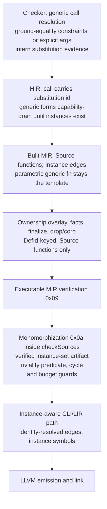

# RFC 0056: Generic Function Monomorphization

## Summary

Generic functions already parse, bind, publish borrow signatures, check
parametrically, and lower parametrically to HIR and post-elaboration
executable MIR. What is missing is the producer the IR algebra has reserved
since RFC 0010: a monomorphization pass that resolves concrete type arguments
at call sites, instantiates one concrete function per canonical substitution,
and routes call edges to those instances. This RFC adds call-site type
argument inference and explicit arguments in the checker (with a stable fact
codec change), a post-executable-MIR monomorphization stage keyed by
`ir::InstanceId`, a new verified instance-set artifact with deterministic
symbols, and an instance-aware LIR/CLI lowering path. The first implementation
slice covers free, unbounded generic functions called with admitted scalar
carriers; later slices add bounds satisfaction, receivers, generic nominal
types, generic-to-generic composition, and cross-module instances.

## Motivation

A call to a generic function is the most basic reusable abstraction in the
language. Today every such call fails closed:

```zom
fn identity<T>(value: T) -> T {
    return value;
}

fn entry() -> i32 {
    return identity(42); // ZOM4099 today
}
```

The declaration itself is healthy: it publishes its borrow signature (the
returned region is parametric), its body checks once against the declared
parameter, and `--dump-hir` / `--dump-mir` show a complete parametric
function whose type-parameter key appears on the result, local, and return
place. The call site drains with `ZOM4099 FunctionBodySemanticsUnavailable`
because two body-checker gates reject generic callees and non-empty explicit
type-argument lists (`readCallable` at `body-checker.cc:5188` and
`directCallShape` at `body-checker.cc:5243`), and no later stage can produce a
concrete callee.

The scaffolding for the missing producer is already in the tree:

- `ir::InstanceId { DefId, CanonicalSubstitutionId, WitnessArgumentsId }`
  exists with zero producers (`compiler/ir/ir-identity.h:74`).
- `IrFailurePhase::Monomorphization = 0x0a` is positioned after executable
  MIR verification, with `RecursiveInstantiation` (ZOM6010) and
  `InstantiationBudgetExceeded` (ZOM6011) failure kinds, instance-scoped owner
  and site types, and cycle/budget detail records.
- `CheckedCallEnvelope` and `DispatchFact` already carry optional
  `substitutions` / `witnesses` evidence, including canonical codecs and
  verifiers; every producer emits none today.
- A deterministic equality constraint engine
  (`checker::inference::InferenceContext`, union-find with an occurs guard)
  exists with no production callers. It binds whole type variables to closed
  ground type ids; it is a ground-equality binder, not a structural unifier.
- The borrow classifier already walks types under a
  `GenericParameterKey -> SemanticTypeId` environment
  (`borrow-interface.cc:257-420`), the local prototype for the general
  substitution utility.

Users cannot write a typed identity helper or any scalar operation shared
across scalar types. The spec already promises the semantics (Ch.03:
"concrete instantiations are monomorphized at code-generation time",
argument-directed inference and ZOM4014; Ch.12: call-site satisfaction
against `T_real`), so this is completing a written contract. Ch.12 does not
yet spell out inference and explicit-argument rules or the slice behavior of
bounds; this RFC adds that normative text.

## Goals

- Accept direct calls to generic free functions with type arguments inferred
  from value arguments or supplied explicitly (`f(x)` and `f<i32>(x)`),
  publishing the resolved mapping as canonical evidence on the checked call
  and dispatch facts.
- Produce one concrete function instance per canonical
  `(generic definition, substitution, witnesses)` triple reachable from a
  non-generic root, by substituting and cloning the post-elaboration
  executable MIR template.
- Publish the instances as a new independently verified session artifact
  with its own revision framing, and route root call edges to instances with
  deterministic, collision-free symbols through LIR, LLVM emission, and link.
- Emit the precise reserved diagnostics for the cases the new code can
  actually reach: ZOM4010 (conflicting inferred arguments), ZOM4014
  (undetermined parameter), ZOM4016 (explicit count mismatch), ZOM4035
  (explicit arguments on a non-generic callee), and ZOM6011 (instantiation
  budget, component ztest only in this slice). Fail closed with ZOM4099
  (value positions) or ZOM4098 (statement positions) for every other
  unsupported shape.
- Keep every non-generic artifact byte-identical for modules with zero
  Instance edges: MIR function records, MIR revisions, ownership fact/overlay
  revisions, dumps, and emitted objects. Modules that gain an Instance edge
  get deliberately changed root call-edge bytes and therefore new MIR,
  overlay, and facts revision digests (the ownership revision chain folds
  upstream bytes); their stability requirement is deterministic reproduction,
  not byte identity, and no ownership fact, key, or event gains an instance
  dimension.

## Non-Goals

- Bound satisfaction at call sites (interface impl lookup, marker bitmap
  checks, ZOM4018) and witness-table production. Every slice-1 instance uses
  one interned canonical **empty** witness record; generic functions with
  non-empty bounds keep the ZOM4099 drain.
- Generic-to-generic calls (a generic body calling a generic callee). The
  checker keeps the ZOM4099 drain for that edge, so the ZOM6010 recursive
  instantiation diagnostic has no source-level producer in this slice; its
  guard is implemented and ztest-covered at the component level.
- Structural type unification and expected-type propagation. The inference
  engine binds whole variables to closed types; nested constraints, coercion
  constraints, and ZOM4011 (infinite type) are unreachable by construction
  and stay without a producer.
- Generic methods, receivers, and `Self`-headed instantiation.
- Instantiation of generic structs, enums, interfaces, type aliases, and
  generic impl heads.
- Calls to generic functions across module or crate boundaries.
- Module-scope value initializers that call a generic function: they keep the
  existing ZOM4104 gate (module initializers admit only literal/binary
  initializers before the body checker runs).
- Trait-object (`dyn`) calls, associated types inside instances, and closures
  or function values capturing generic parameters.
- Any ABI classification work: instance parameters and results are restricted
  to the carriers the existing scalar LIR ladder admits (i32 and bool first).
- GC-shape sharing, polymorphization, and cross-revision instance reuse.

## Prior Art

- **Rust monomorphization (primary model).** Rust collects instantiations
  from call sites, recursively expands generic callees, detects cycles with a
  recursion limit, and emits one codegen item per concrete type set with a
  hash-suffixed symbol. ZOM copies the overall shape: fixpoint collection
  from roots, canonical `(def, substitution)` keys, deterministic budgeting,
  and digest-disambiguated symbols. ZOM avoids polymorphization and
  cross-crate metadata complexity in the first slice.
- **C++ frontend template instantiation (rejected).** C++ type-checks a
  template again per instantiation from source. ZOM checks the generic body
  exactly once against declared bounds, lowers one parametric MIR function,
  and derives instances by substitution, keeping diagnostics independent of
  the call-site set and keeping the frontend out of codegen.
- **Swift generics (witness tables, deferred).** Swift passes reified type
  metadata and witness tables for bounded generics. ZOM has no runtime type
  reflection and slice 1 admits no bounds, so instances take no metadata
  parameter; the `witnesses` component of `InstanceId` is reserved and is the
  single canonical empty record until a later RFC implements bounds.
- **Go generics (GC shape stenciling, rejected).** Go groups concrete types
  into GC shapes to share machine code. ZOM emits a distinct instance per
  canonical substitution first; grouping needs an ABI/layout foundation the
  backend does not have and is intentionally absent.

## Guide-Level Explanation

A generic function is written once and used at any concrete type:

```zom
fn identity<T>(value: T) -> T {
    return value;
}

fn entry_a() -> i32 {
    return identity(41);      // T inferred as i32
}

fn entry_b() -> i32 {
    return identity<i32>(1);  // T given explicitly
}
```

The compiler checks `identity` once. Each distinct call-site substitution
yields one concrete specialization in the emitted binary. Two calls with the
same substitution share one specialization; different substitutions produce
different ones. A type argument that cannot be determined from the value
arguments is rejected at the call with ZOM4014 and a note naming the
parameter and suggesting explicit arguments. Conflicting inferred arguments
(`same(1, true)`) are rejected with ZOM4010; wrong explicit count is
ZOM4016; explicit arguments on a non-generic callee are ZOM4035. Exceeding
the fixed instantiation budget is ZOM6011. Constructs outside the first
slice (bounded generics, generic methods, aggregate type arguments,
generic-to-generic calls, module-initializer calls) keep today's ZOM4099 or
ZOM4104 diagnostic.

## Reference-Level Design

### Stage ordering



Phase 0x0a runs inside `CompilerSession::checkSources()` immediately after
the executable-MIR verification transaction loop
(`compiler-session.cc:4119-4189`). Consequently `zomc compile --check`
observes stage 0x0a failures, and the diagnostics lit runner (which drives
`compile --check`) can pin them. The artifact is staged and committed in the
same per-module transaction; the count invariants at
`compiler-session.cc:4166-4189` are extended to cover the instance set.

### 1. Checker: call-site resolution and evidence

The generic callee's `CallableSignature.genericParameters` are ordered by
declared ordinal; each carries a content-derived canonical
`identity::GenericParameterKey` (SHA-256 over `(owner, kind, ordinal)` under
the `zom.generic-parameter` domain separator) and a separate positional
`index`.

**Substitution record contract change.** The existing
`SubstitutionData { Vector<identity::DefId> parameters;
Vector<SemanticTypeId> arguments; }` is keyed in the wrong identity domain:
generic parameters are not definitions, and the canonical codec encodes this
vector through the definition authority (`checked-facts.cc:449-466`). No
non-empty record has ever been produced. Slice 1 changes the field to
`Vector<identity::GenericParameterKey> parameters`, routes its canonical
encoding through the generic-parameter authority, and updates, in one
transaction, the checked-facts verifier, the dispatch-fact codec and
verifier, the fixed-wire oracle in `checked-facts-test.cc`, and every
reader. Empty records encode identically before and after, so non-generic
artifacts stay byte-identical.

**Explicit form `f<i32>(args)`.** Two sets are distinguished:
- the **type-name resolution set** is every predefined scalar type name
  (`i8`..`i64`, `u8`..`u64`, `isize`, `usize`, `f32`, `f64`, `bool`, `char`),
  resolved through a small shared resolver extracted from the
  translation-unit-local signature-stage `SourceTypeBuilder` (that component
  writes signature-stage channels and is not called directly from the body
  stage);
- the **admitted carrier set** is the set the scalar LIR ladder lowers,
  initially exactly `{i32, bool}`.

A type argument that resolves through the name set but is outside the
carrier set keeps the ZOM4099 drain (for example `identity<f64>(x)`); an
explicit argument outside the name set (unknown name, nominal, aggregate,
qualified path) also keeps ZOM4099. Existing literal-range and coercion
checks run during call resolution BEFORE the carrier gate and keep their own
diagnostics, exactly as for non-generic calls: `identity<u8>(42)` narrows the
in-range literal successfully (like `take_u8(42)` today) and then drains
ZOM4099 at carrier admission; `identity<u8>(300)` fails ZOM4077
(BodyLiteralOutOfRange); `identity<u8>(i32_variable)` fails ZOM4009.
Wrong argument COUNT on a generic callee is ZOM4099 on HEAD, so Stage 2 must
route generic callees through the existing arity check to PRODUCE ZOM4036.
Count mismatch from the explicit-argument form likewise emits ZOM4016;
explicit arguments on a non-generic callee emit ZOM4035. Default type
parameters are not admitted (their presence keeps ZOM4099).

**Inferred form `f(args)`.** Per argument position, the argument's already
produced closed ground type is bound against the parameter's type:
- a bare type-parameter parameter `T` binds that parameter's variable to the
  ground type;
- a second binding for the same parameter that disagrees is a user type
  conflict reported as ZOM4010 `CannotUnifyTypes` through the existing
  recovery-ledger/TypeErrorId lifecycle (`InferenceContext` solve returns
  `SolverStateInvalid`);
- a parameter with no binding at call close is ZOM4014
  `CannotInferTypeParameter`. Its display schema is changed from
  `Kind::Definition` to `Kind::Type`, carrying the `TypeParameterTypeData`
  type; the slice-1 rendered argument is the existing
  `<type-parameter#ordinal>` form (no source-name note is added). This
  schema change serves only the generic-call producer; the separate
  Ch.03-promised ZOM4014 use for an unresolved local inference variable
  stays producer-free and its Ch.03 sentence is scoped in the documentation
  plan;
- parameter forms outside bare type parameters (aggregates, nested
  positions, coercions) are not constrained in this slice; the call keeps
  ZOM4099.

**Carrier admission (single checker enforcement point).** After resolution,
and before any substitution evidence is interned, every resolved argument
type must be a member of the admitted carrier set (`{i32, bool}` initially),
for BOTH the inferred and explicit forms. A resolved closed ground type
outside that set — `i64`, `u8`, floats, raw pointers — keeps the ZOM4099
drain even though it is closed and region-free: the checker must not publish
an instance the LIR ladder cannot lower. The instance verifier independently
re-checks the same membership (§4), so mono cannot publish a non-ladder
instance if a later checker change widens inference.

`InferenceContext` is used per call site: create, issue one variable per
generic parameter, add ground equalities, solve, materialize, finish; the
occurs guard stays as a defensive invariant with no user-facing producer
(ZOM4011 is not emitted in this slice).

The resolved mapping, in canonical parameter order, is interned in the
module's `FrozenSubstitutionStore`. Slice 1 also interns exactly one
canonical empty `WitnessArgumentsData` record per context. Its valid
`WitnessArgumentsId` is carried on the generic call's
`CheckedCallEnvelope.witnesses` and `DispatchFact.witnesses` (so the
existing evidence slots, cross-validation, and record-byte provider are the
complete delivery path to `InstanceId::from`; a default handle fails
`InstanceId::isValid`). Ordinary non-generic direct calls keep their
`Maybe`-none witness. The record-byte provider threaded into MIR construction
serves bytes for both the substitution and witness stores.

**Result and carrier types.** A new general substitution utility
`substituteType(SemanticTypeStore&, SemanticTypeId,
ArrayPtr<const TypeSubstitution>)` walks all 16 `TypeDataTag` branches
exhaustively: `TypeParameter` maps to its argument, every composite branch
rebuilds substituted children and re-interns canonically. The call result
type and each argument's parameter-facing type are substituted closed types;
`CheckedCallEnvelope.calleeType` stays the **unsubstituted** generic function
type. Carrier admission sees only closed types. The borrow classifier adopts
the shared `TypeSubstitution` mapping type but keeps its lazy environment
walk: borrow classification is a read-only analysis and its cross-module
rebuild path holds a const store that must not intern, so canonical
`substituteType` calls are made by the mutable-store checker and mono stages
(Stage 2 onward), while call-site classification continues to run on the
substituted types and must resolve to `NoRegion` for an admitted instance.

Integer-literal and coercion interactions are pinned by the Stage 2 in-body
lit cases described in the Test Plan: `identity<u8>(42)` narrows the in-range
literal and then drains ZOM4099 at carrier admission, `identity<u8>(300)` is
ZOM4077, and `identity<u8>(i32_variable)` is ZOM4009; wrong argument
**count** on a generic callee is ZOM4099 on HEAD and Stage 2 produces ZOM4036
through the existing arity path.

### 2. HIR: evidence field, position matrix, and honest capability drain

`HirDirectCallExpression` gains two related optional fields:
`Maybe<checked::CanonicalSubstitutionId> substitution` and
`Maybe<checked::WitnessArgumentsId> witnesses`. The witness field is present
(holding the per-context canonical empty-witness id) exactly when the
substitution field is present; both are none on ordinary Source direct
calls. The fields are cross-validated against
`CheckedCallEnvelope.substitutions/witnesses` and
`DispatchFact.substitutions/witnesses`. Their canonical records gain bytes
only when populated; the HIR text dumper renders either new field **only
when present**, and prints a `Source` direct call exactly as today, so the
`--dump-hir` text of every existing source is byte-identical and the IR
parity channel has no dump-text drift. HIR fingerprint golden records for
modules with generic calls are regenerated and human-reviewed in Stage 2;
MIR revisions and emitted objects are unaffected.

**Capability kinds follow position.** The projector maps
`UnsupportedSourceConstruct` to ZOM4099 and
`UnsupportedExpressionStatement` to ZOM4098. Generic-call admission and the
converted HIR guards must preserve that distinction:

- value positions (return value, initializer, rvalue operand, block-tail
  value, `if` condition value) drain as `UnsupportedSourceConstruct`
  (ZOM4099);
- a generic call appearing as a bare expression statement is not admitted in
  slice 1 and keeps `UnsupportedExpressionStatement` (ZOM4098), the code the
  statement-position drain already produces today.

**Auditable guard conversion, not a blanket rewrite.** The checker
shape-classifies by syntax, so once generic callees are admitted a call can
reach every HIR call arm (the direct-return and initializer arms and the
guard family at `hir-builder.cc:964, 1141, 1271, 1445, 1576, 2142, 2253,
2418, 2560, 3162, 3458, 4209, 4749, 4855, 4977, 5290, 5353, 5916, 5970,
9749, 9887, 9928, 9941`). Stage 2 converts each arm's reachable generic form
from `rejectHir`/`MissingRequiredFact`/`InvalidFact` to the position-correct
`rejectHirCapability`; the exhaustive position matrix lit suite
(statement, initializer, return, block-tail, condition; each with inferred
and explicit forms) asserts only capability codes are ever emitted and never
an internal incident. Stage 3 then replaces each drain arm with the real
substitution-carrying admission arm by arm; `compile --check` can only flip
to pass once the specific arm admits. A populated substitution id is
consumed only by the new generic-call admission; no legacy arm may see one.

### 3. MIR identity: instance edges, DefId owners, no new revision field

Only the **call edge** becomes instance-capable. The function owner does not
move:

```text
MirCallableIdentity = Source(identity::DefId) | Instance(ir::InstanceId)
```

- Changed: `MirCallTerminator.callee` (and its factory, canonical
  encoder/decoder/verifier) from `DefId` to `MirCallableIdentity`; the MIR
  record-byte provider; the mono artifact; the LIR owner bridge; the
  translation validator.
- **Not changed: `MirFunction.owner` stays `identity::DefId`.** Every Source
  function is Source-owned by construction, so the 86
  `MirLocation{function.owner, ...}` construction sites across 8 ownership
  files, the pinned gate strings `hasBorrowCommit(overlay, function.owner,
  point)` / `hasBorrowIssue(...)` and
  `MovePathKey{mirFunction.owner, ...}` in
  `scripts/check-ownership-architecture.py`, and all 13 fact families stay
  byte-identical.
- The single ownership-layer callee reader
  (`ownership-event-overlay.cc:1566`, guarded by
  `MirCallEffectKind::ActivateMutableReceiver`, a receiver-only deferral
  path) is not in the pinned set; it compares as a Source edge. Slice-1 free
  function calls use `noActivation()`, so the comparison is behaviorally
  unchanged, and an `Instance` value there is rejected as an invariant.
- Mono instances are not `MirFunction` values inside the source Built MIR
  module: they are entries of the separate instance-set artifact (§4), each
  a cloned `MirFunction` body paired with its `InstanceId`. The LIR bridge
  gains an instance-aware owner value, and the translation validator's
  presented input becomes a joined Source+instance presentation type (§6).

**Callee-slot wire rule.** Inside the `Call` terminator encoding, the callee
slot is one length-framed byte string. A `Source` edge is today's exact
payload: the u64 little-endian length prefix `0x20` (`encodeByteString` over
the fixed 32-byte `DefinitionKey`). An `Instance` edge uses a new
domain-separated, length-framed form whose leading tag byte is chosen so the
full prefix can never equal the Source `0x20` length prefix; the MIR
verifier independently re-decodes every callee slot and rejects any slot
that matches neither framing.

**Byte preservation for Source modules.** With no Instance edges the callee
slot is exactly today's bytes, so source function records, the MIR revision,
and all ownership revisions stay identical. Modules with an Instance edge
have deliberately different root call-edge bytes; because the overlay and
the 13 ownership fact revisions fold upstream MIR bytes
(`ownership-event-overlay.cc:2821-2826`, `ownership-facts-codec.cc:963-965`),
their revision digests change. That is expected and deterministic; stability
is proved by a Stage 3 project-native cross-build ztest (not by
`check-ownership-determinism.py`, whose frozen three-input corpus and
process-text channel cannot observe revision digests or packages): the test
runs two independent `checkSources` builds of the admitted body program and
asserts equality across builds of the Built `MirRevisionId`,
`CheckedMir::eventOverlayRevision()`, and `CheckedMir::factsRevision()`, and
separately asserts zero-edge modules keep their pinned digest oracles. No
fact payload or key gains an instance dimension — that structural fact is
enforced by keeping owners DefId-based and by
`check-ownership-architecture.py`, not by the determinism test.

**Where instance edges come from.** Built MIR construction emits
`Instance(InstanceId)` on a call terminator whenever the call's checked
envelope carries a substitution; it never rewrites a verified function. The
builder needs the canonical substitution and empty-witness record bytes, so
`BuiltMirInput` gains a read-only record-byte provider over both frozen
stores plus its retaining lease, threaded through
`encodeTerminator`/`encodeFunction` and the verifier. **No new digest enters
`MirRevisionCodec`**: the record bytes are already bound transitively
because `encodeBuiltFramed` folds the checked-facts and dispatch-facts
revisions, whose canonical frames already include the substitution and
witness record groups (`checked-facts.h:989-991`). Source-only modules pass
no records and their frame is unchanged. A malformed edge found at build or
verify time is reported Definition-owned (the containing Source function),
matching the existing `rejectMir` behavior; instance-owned failure
descriptors are produced only by the mono stage and post-0x0a consumers.

### 4. Monomorphization stage: verified instance-set artifact

**New artifact.** A new component `compiler/mono/` (own library, explicit
CMake source list, registered in `compiler/CMakeLists.txt`) produces one new
published artifact: a verified monomorphized instance set per module. An
instance entry pairs a cloned `MirFunction` body with its
`ir::InstanceId`; the artifact has a builder, an independent fail-closed
verifier, a canonical revision over length-framed instance identity bytes
(separate from `MirRevisionCodec`), and staged session storage and getter,
committed in the same `checkSources` transaction. Generic parametric
templates remain Source functions in the source MIR module and are members
of neither the LIR/object presented set nor the translation-validator input
(§6); they remain visible in the source `--dump-mir`, and the instance set
gets its own `--dump-mir` "instances" section when non-empty.

**Template source.** Each instance is cloned from the callee's
**post-elaboration verified executable MIR** template (the output of
`ExecutableMirVerifier`), so instances never silently skip drop or coroutine
elaboration. For the admitted slice elaboration on the template is a no-op,
which the admission predicate below guarantees.

**Fixpoint.** Roots are the non-generic `Source` functions (the same
"lower every bodied definition" set the backend uses today); only edges
present in scanned functions create instances, so no instance is produced
without a call edge. A worklist in deterministic function/block/statement
order maps each `Instance` edge to its id, appends a cloned instance on
first sight, and rescans; same-substitution self-calls are idempotent and
stay ordinary recursion. Generic-to-generic edges are not produced by the
checker in this slice, so substitution composition is specified but unused.
Final ordering is a byte sort over the expanded instance identity; roots
keep source order.

**Substitution walk.** The clone rewrites every `SemanticTypeId` carrier:
function signature (parameters, success, raises), every local's type,
constants, `MirPlace.rootType`/`resultType`, **every projection's**
`inputType`/`resultType`, and rvalue-carried types (comparison, arithmetic,
erase, error-union, extract-field, aggregate). `DefId`-bearing rvalue fields
(nominal aggregate definitions/fields, downcast, set-discriminant) are
asserted unreachable in the scalar slice, not substituted.

**Instance verifier.** Independently re-encodes every instance and enforces:
1. no residual type in the instance body references any of the callee's
   generic parameter keys;
2. carrier membership: every substituted parameter, result, local, constant,
   place-carried, and rvalue-carried type is in the slice-1 admitted scalar
   set (`{i32, bool}`) — the same predicate the checker applied, re-checked
   here independently;
3. ownership triviality: no type among those carriers is a
   `Reference`/`RawPointer` branch and the body contains zero
   `MirStatementKind::BorrowCreation` statements
   (`MirBorrowCreationStatement` is the sole reference-construction
   statement; there is no borrow rvalue), zero
   `MirStatementKind::UnsafeScopeBoundary` statements, and zero
   `MirStatementKind::Deinitialize` statements; every call edge in a
   published instance additionally carries `MirCallEffect::noActivation()`;
   admitted scalar carriers are no-region, no-drop-glue, trivially-copyable
   by construction;
4. template lineage: the cloned template is the verified post-elaboration
   executable MIR for that definition at the same semantic context, with its
   embedded overlay/facts/proof lineage revisions (the wrapper lineage
   triple), so "the template passed standalone ownership analysis" is read
   from concrete evidence, never assumed;
5. edge keys and arity: every `Instance` edge's substitution parameter keys
   and count equal the callee's ordered generic parameters, and every such
   edge resolves to a member instance (edge closure);
6. identity ordering and the fixed instance-count/substituted-node budgets.
Failure is a capability rejection (ZOM4099 for an inadmissible carrier or
body; ZOM6011 for an exceeded budget), instance-owned from this stage on,
never an internal incident.

**Recursion and budget.** A chain whose head definition repeats with a
strictly growing nested substitution fails ZOM6010 with root and chain;
unreachable without generic-to-generic edges, so the guard is ztest-only at
component level in this slice and gets no normative spec sentence or source
fixture yet. Fixed instance-count and substituted-node limits fail ZOM6011
with recorded counts; with only two admitted scalar carriers the limit is
likewise unreachable from a source program in this slice, so ZOM6011 also
lands as a component ztest plus an IR design-note description, with no
Ch.12 sentence or source fixture until a later slice widens carriers. The
numeric defaults are fixed alongside the ZOM6011 ztest.

### 5. Instance identity expansion

Instances need canonical byte expansion for failure facts encoded from phase
0x0a onward. The shared encoder emits an instance-domain separator followed
by length-framed components: definition key bytes, the canonical
substitution record bytes, and the canonical (empty) witness record bytes —
framed with `encodeByteString`-style length prefixes so the mapping is
structurally injective when variable-length witness records arrive later.
Every component is validated with `belongsTo(context)`; failure is
`InvalidHandle`. Digests reuse `identity::Sha256Digest` and the canonical
encoders under `compiler/identity/canonical/`.

Enablement is scoped to components that can actually admit instance-owned
descriptors: the mono producer and the post-0x0a LIR, LLVM translation,
object-emission, link, and publication paths, which receive the frozen-store
record-byte provider through their existing lease/repository inputs. The HIR
resolver (`hir-internal.h:73`) and the 17 ownership fact/overlay resolvers
keep their live authority-backed `Module`/`DefId` expansion exactly as today;
only their `expand(InstanceId)` overrides stay unconditional rejections,
each with a comment stating instances are unreachable at those phases
(ownership consumes only pre-mono Source functions; phase 0x0a never flows
back). They do not adopt the all-rejecting `UnusedIdentityResolver` class,
whose Module/DefId overrides also reject. Threading frozen-store leases into
the ownership reject sites is explicitly out of scope: their descriptors are
Definition-owned at phases 0x06/0x07/0x09 by construction.

### 6. Symbols, LIR, translation validation, and the CLI

- Instance symbols are derived, never positional:
  `zom.mono.<definition-key hex>.<digest>` where the digest covers the framed
  substitution record and, from the first non-empty witness onward, the
  framed witness record as well. The `zom.mono.` domain cannot intersect
  `zom.module_init`, `zom.caller`, `zom.callee`, `zom.leaf`, or
  `zom.standalone_N`.
- LIR call edges remain positional indices. Owner/callee identity matching
  is routed through ONE shared helper that compares the full
  `MirCallableIdentity` (Source DefId or Instance triple) and is used at
  every one of the 31 identity-comparison sites in
  `translation-validator.cc` — including the per-shape entry/mid/leaf
  terminator checks, the standalone entry/leaf resolution loops, the
  single-function existential/dyn owner bijections, the single-function
  `validate` bijection, and the module-level "every MIR owner matches exactly
  one LIR owner" loop. A hand-maintained per-site allowlist is forbidden, so
  the two-instances-of-one-definition ambiguity cannot reappear at an
  unlisted site (notably the module bijection loop); shapes the slice never
  routes still compile against the helper and keep failing closed there.
- The presented MIR set for LIR, the validator, and object emission is
  exactly: concrete non-generic Source functions plus the member instances
  reachable from them. Generic parametric templates are excluded (their
  carriers contain unbound type parameters; including them breaks the
  exact-owner bijection and misroutes the two-function heuristic), yet stay
  in source MIR and its dump; instance symbols never participate in
  `zom.module_init` entry selection. The presentation becomes a joined
  Source+instance type assembled in the CLI, which is what the validator
  receives.
- The zomc lowering selection gains an explicit instance-aware branch taken
  **before** the 1/2/3/4+-function legacy ladders: it identifies Source roots
  with `Instance` edges, lowers each instance through the existing scalar
  shape rules (an identity instance uses the direct-call/caller-callee
  rails), and joins them with the roots; modules without instance edges take
  the untouched source-only arrays and legacy ladders. Because the presented
  argument becomes the joined type, the pinned
  `lir::TranslationValidator::validate(presentedMir.asPtr(), lirModule,
  types)` marker in `utils/zomc/zomc.cc` moves to the joined accessor;
  `scripts/check-lir-verification-gate.py` and its `--self-test` mutation are
  updated in the same change (see Gate Updates).
- LLVM translation is structurally unchanged: functions emit by symbol and
  calls by resolved index. The link plan gains no per-function table.

## Repository Impact

| Area | Paths | Owner |
|---|---|---|
| Generic call checking, inference lifecycle, substitution codec contract, shared type substitution, call evidence | `compiler/checker/**`, `compiler/type/**` | binder-checker |
| HIR call record, capability-drain conversion | `compiler/hir/**` | binder-checker |
| Diagnostic producers ZOM4010/4014/4016/4035/6011 and display schema | `compiler/diagnostics/**`, projections | binder-checker |
| Spec Ch.12 call-site type arguments, staged instantiation text, honest bounds scope | `docs/spec/chapters/12-generics.md` | binder-checker, spec-audit |
| Spec Ch.03 inference-rule scoping and ZOM4014 sentence split | `docs/spec/chapters/03-types.md` | binder-checker, spec-audit |
| MIR callable identity, instance edges, record-byte provider, revision inputs | `compiler/mir/**` | ir-backend |
| Monomorphization component and artifact | `compiler/mono/**` (new), `compiler/CMakeLists.txt` | ir-backend |
| Session stage wiring, staged storage/getter, transaction invariants | `compiler/driver/session/**` | ir-backend |
| Instance identity expansion (0x0a+ paths only) | `compiler/ir/**`, `compiler/lir/**`, `compiler/backend/llvm/**` | ir-backend |
| LIR identity resolution, symbols, translation validation, CLI branch, MIR dump | `compiler/lir/**`, `compiler/backend/llvm/**`, `utils/zomc/**` | ir-backend |
| Borrow and ownership analysis Source-only key readers; unused instance-expansion pattern | `compiler/ownership/**` | runtime-memory |
| Unit/lit/conformance/native tests, gate markers, CMake, parity snapshots | `tests/**`, `scripts/**` | verification |

### Gate Updates

- `compiler/CMakeLists.txt`: add the `mono` subdirectory; new
  `compiler/mono/CMakeLists.txt` with explicit sources; register include
  prefixes in the CMake-time gate (`cmake/utils/functions.cmake`).
- `scripts/check-ir-architecture.py`: add the mono target wiring marker and
  its negative self-test mutation, following the existing marker pattern;
  preserve the `add_subdirectory(mir)` / `$<TARGET_OBJECTS:mir>` markers; any
  marker pinning the `MirTerminator::call`/callee spelling moves with the
  `MirCallableIdentity` change plus a `--self-test` mutation update.
- `scripts/check-ownership-architecture.py`: unchanged and must stay green
  without marker edits — `MirFunction.owner` and all ownership keys remain
  DefId-based; the sole callee reader at `ownership-event-overlay.cc:1566`
  is not a pinned string and its Source comparison behavior is unchanged.
- `scripts/check-lir-verification-gate.py`: the pinned zomc `validate(...)`
  call-site marker moves to the joined Source+instance presented accessor;
  the gate's expected string and its `--self-test` mutation are updated in
  the same change.
- `scripts/check-compiler-session-architecture.py`: new markers for the
  staged instance-set vector, its per-module population after the
  executable-MIR verification loop, the extended count-invariant block at
  `compiler-session.cc:4166-4189`, and the atomic publication move;
  `--self-test` mutations are added alongside each new marker.
- Also run with moved markers in `--self-test` mode:
  `check-diagnostic-coverage.py` (new real producers),
  `check-spec-alignment.py` (Ch.12 text), `check-ownership-determinism.py`
  (baseline must stay green), `check-lit-exec-root.py` (new expectations).

## Security And Safety Impact

None beyond the compiler's existing fail-closed guarantees. Instantiation is
a deterministic derivation from checked inputs: no new source parsing, no
user-controlled paths or symbols outside the compiler's mangling, no runtime
metadata. The cycle and budget guards bound compilation resource use. The
ownership-triviality predicate is independently enforced on every instance
before publication, so widening admitted carriers later cannot silently emit
ownership-unanalyzed code: any non-trivial instance drains ZOM4099 until
RFC 0007 instance ownership lands. Instances pass the same structural MIR and
LIR verifiers as source functions.

## Drawbacks And Risks

- The `SubstitutionData.parameters` identity-domain correction is a stable
  fact codec change; it is safe only because no non-empty record exists
  today. It must land atomically with codec, verifiers, dispatch, and oracle
  updates.
- Widening the MIR call-edge identity and adding the mono artifact touches
  several call sites; the tight scoping (the call terminator only;
  `MirFunction.owner` and the entire ownership key layer stay DefId) limits
  the blast radius, byte preservation of Source edges plus the pinned
  revision oracles make a wrong encoding a test failure rather than silent
  drift, and the joined presented type keeps the template out of LIR.
- MIR-level instantiation fixes type carriers but cannot express layout- or
  witness-dependent bodies. The stage boundary, artifact, and instance
  identity are chosen so the producer can later rebuild from an earlier layer
  behind the same component interface without changing checker, LIR, or
  symbol contracts.
- Bounds are unchecked in slice 1; bounded generics therefore remain
  undrainable-to-instance and keep ZOM4099 until witness production lands.

## Alternatives Considered

- **Instantiate at HIR by rebuilding from AST.** Requires fresh dense node
  ordinals and pool merging against the strict one-pool HIR verifier and
  re-entry into semantic checking. The MIR-level clone reuses the standalone
  per-function MIR object model, consumes the already-elaborated executable
  template, and matches the reserved 0x0a position. HIR rebuild remains a
  fallback if later aggregate/layout instantiation demands it.
- **Rewrite the verified root's call edge at mono time.** Rejected: the root
  is held behind immutable lease-checked verified wrappers. Instance edges
  are emitted at Built MIR construction from checked evidence; mono only
  appends instances.
- **Emit instances from the CLI ladder.** Rejected: it would place semantic
  decisions in the driver, duplicate substitution logic, and bypass session
  verification. The CLI consumes the verified instance set.
- **Enable real `expand(InstanceId)` in the ownership resolvers.** Rejected:
  the sites are unreachable by construction and would require frozen-store
  lease threading through 17 reject-only paths. The documented unused-resolver
  pattern is the fail-closed answer.
- **Reuse parametric machine code across types (GC shapes).** Rejected: no
  ABI/layout classifier exists; grouping can be added without changing
  instance identity.

## Compatibility And Rollout

Pre-1.0 internal compiler change; no shims, no dual paths. One numbered
sequence is used by this RFC and the tracker; every stage carries its own
tests, and no stage is tests-only.

1. **Stage 1, substitution utility (no behavior change):** the exhaustive
   `substituteType` helper, borrow-classifier refactor, ztest per
   `TypeDataTag`; all revisions and parity snapshots unchanged.
2. **Stage 2, frontend generic-call admission:** substitution codec contract
   change; checker inference/explicit resolution with ZOM4010/4014/4016/4035
   producers and their ztest/lit coverage in the same change, with generic
   callees routed through the existing arity check so wrong count yields
   ZOM4036 and the literal/coercion precedence (4077/4009, u8 narrows then
   drains) pinned; checked and
   dispatch evidence (including the empty-witness id) populated; HIR fields
   plus the position-matrix capability-drain conversion. Every resolved
   generic call still fails closed after this stage: value positions ZOM4099,
   statement positions ZOM4098, module initializers ZOM4104. New
   in-function-body corpus fixtures carry the four precise diagnostics (the
   existing module-scope `generic_explicit_count_neg_10` and
   `generic_infer_unsolved_neg_09` stay pinned at ZOM4098 as bare expression
   statements, and `generic_explicit_non_generic_neg_13` stays pinned at
   ZOM4104 — their hashes do not change). HIR fingerprint goldens for
   direct-call modules are regenerated and human-reviewed; `--dump-hir` text
   and MIR/object bytes are unchanged. Both parity snapshots are regenerated
   (commands in the Test Plan); the reviewed diff is exactly the new fixture
   files plus the fingerprint golden regeneration.
3. **Stage 3, instance artifact:** `MirCallableIdentity` on the call edge,
   instance edges at MIR build, `compiler/mono/`
   builder/verifier/revision/session stage with the §4 predicates, identity
   expansion for 0x0a+ components, and ztest coverage (fixpoint, sharing,
   ordering, full node walk, residual-key, carrier-set and triviality
   rejection, edge arity, ZOM6011 budget, component-level ZOM6010 chain).
   This stage replaces the HIR drain arms arm by arm with real admission; a
   new named corpus source — an admitted identity call in a function body,
   `generic_infer_identity_body_pos_17.zom` (inferred i32) plus an explicit
   sibling `generic_explicit_body_pos_18.zom` — flips `compile --check` from
   ZOM4099 to pass, and these are the ONLY process-parity flips; their IR
   channel records the instance edge bytes. Chained overlay/facts revision
   flips are covered by the Stage 3 cross-build ztest, not corpus parity,
   which renders neither. The integration consumer still rejects at this
   stage; its evidence is Stage 4. Object emission still rejects via the
   existing CLI path.
4. **Stage 4, native path:** instance-aware CLI/LIR branch, derived symbols,
   full-identity translation validation, `--dump-mir` instances section; the
   reject fixture is replaced (delete the `--reject-case` tuple
   `tests/CMakeLists.txt:471` and the package directory, add an
   object-emission `--case` in the `object-emission-cli` block, add a
   `--run-case .../generic-identity-consumer/Zom.toml::generic_identity_consumer::generic_identity_consumer::42`
   in the `native-run-cli` block); corpus parity stays stable; the native run
   exits 42; a backend/session ztest builds the package twice independently
   and compares the emitted object bytes byte-identical, the package-level
   determinism evidence for an edge-carrying module (parity and the native
   harness render no revisions).

Rollback is one revert per stage.

## Documentation And Teaching Plan

Spec text is staged sentence by sentence with its producer; no paragraph
describes behavior without a source-level acceptance test.

- **Stage 2, `docs/spec/chapters/12-generics.md`:** a short "Call-Site Type
  Arguments" subsection written strictly at what Stage 2 makes observable, in
  two layers. Resolution layer: (a) call-site type arguments are solved by
  binding equality constraints between argument types and bare type-parameter
  parameters — bare `T` positions only, no expected-type propagation, no
  structural positions, in Ch.03 vocabulary and cross-referencing its
  inference sections; explicit type arguments resolve for predefined scalar
  type names; (b) the four resolution-failure conditions
  ZOM4010/ZOM4014/ZOM4016/ZOM4035, each with its new in-body corpus fixture.
  Call-acceptance layer: one explicit boundary sentence stating that in this
  revision every resolved generic call is still rejected BEFORE
  instantiation — ZOM4099 in value positions, ZOM4098 as a bare expression
  statement, ZOM4104 in a module initializer — and that instantiation of
  free, unbounded functions over admitted scalar carriers is reserved; the
  subsection must not state or imply that any generic call is accepted
  end-to-end. The subsection opens with a scope sentence naming what is not
  covered: bounded functions, default type parameters, generic classes and
  enums, generic methods, and tuple/aggregate type arguments — so the
  chapter's existing `pair`/`max`/`parseValue`/`Box`/bound-list/`Option`
  examples cannot be read as implemented. The existing "Bound Satisfaction
  at Call Site" paragraph is rewritten to verified behavior: bounds are
  parsed, recorded, and declaration-site validated (the ZOM4129 family has
  lit producers today); bodies are checked parametrically against the
  abstract parameter; call-site satisfaction (impl lookup ZOM4018, marker
  bitmap checks, witness production) and positive bound-using member
  resolution are not implemented, are marked reserved, and land with
  witnesses.
- **Stage 2, `docs/spec/chapters/03-types.md`:** the general inference-engine
  description at `:13` (overview) and `:714` is scoped consistently from
  blanket "first-order unification" to the implemented equality-constraint
  solving (whole-variable-to-ground-type binding; structural unification
  reserved), so the two sentences cannot contradict each other; a separate
  call-site rule sentence then points at the new Ch.12 subsection for the
  bare-`T`-only restriction, and the `:758` call-rule row gains a
  cross-reference to it. The `:726` ZOM4014 sentence is split so its
  generic-parameter meaning lands now (single catalog headline verbatim,
  rendered as `<type-parameter#ordinal>`) and its unresolved
  local-inference-variable meaning is explicitly marked unimplemented.
  Lines `:12`, `:333` stay textually unchanged and become true slice-wise
  (the code-generation monomorphization claim is fulfilled only in Stage 4);
  the touched-line list (`:13`, `:714`, `:726`, `:758`) and the unchanged
  list are both recorded in the spec change's review.
- **Stage 3:** Ch.12 gains only the positive instantiation/shaping sentence
  now observable through `compile --check` — one verified instance per
  canonical substitution, deduplicated and independently verified — anchored
  to the two new body fixtures, and explicitly noting object/binary emission
  is not yet available. No ZOM6010 or ZOM6011 normative text is added:
  neither is source-reachable in this slice.
- **Stage 4:** Ch.12 gains the code-generation sentence anchored to the
  exit-42 consumer.
- **Post-Stage-4 follow-up (registered, not part of this RFC's acceptance):**
  a dedicated spec change annotates each still-unimplemented Ch.12 example
  section — `pair<T,U>` (`:13-16`), `max<T: Comparable>` (`:18-21`),
  `parseValue<T = str>` (`:23-27`), `Box<T>` classes/methods and the
  `Box(42)` usage (`:30-55`), the four bound-list examples (`:117-147`),
  and the `Option`/`Result` generic enums (`:209-221`) — with a
  reserved/illustrative status marker, tracked in the RFC tracker rather
  than left to implication.
- A compiler IR design note under `docs/design/ir/` lands with Stage 3 and
  describes builder, independent verifier, session publisher, consumers
  (LIR/LLVM), template-vs-instance distinction, dump surface, AND the
  representable-but-not-source-emitted ZOM6010/ZOM6011 guards.
- Diagnostic catalog text for the produced codes is completed verbatim with
  each producer stage.

## Operational Readiness

None. Monomorphization runs inside the existing compile invocation under
fixed internal budgets, adds no CLI surface, and requires no runtime or
packaging change. Instance/budget rejections are ordinary compile
diagnostics carrying expansion chains.

## Acceptance Criteria

- `identity(42)` and `identity<i32>(42)` compile and run; the native consumer
  exits 42. End-to-end execution is proved by the run tuple; instance
  sharing (one symbol per substitution, two for distinct substitutions) is
  proved by a mono ztest over the instance set and optionally bounded ELF
  symbol inspection, not by the exit code.
- Generic declarations alone produce one parametric template and no error.
  For every module with zero Instance edges, MIR function records, MIR
  revisions, ownership fact/overlay revisions, `--dump-hir`/`--dump-mir`
  text, and emitted objects are byte-identical (pinned oracles in
  `built-mir-test.cc:95,102,401-414,447,463` and the ownership gate digest
  unchanged). Modules with Instance edges have deterministic, reproducible
  new edge and chained revision bytes across independent builds (proved by
  the Stage 3 cross-build session/mono ztest over Built MIR, overlay, and
  facts revisions), with no instance dimension added to any ownership key or
  fact payload (enforced structurally and by
  `check-ownership-architecture.py`).
- ZOM4010, ZOM4014, ZOM4016, ZOM4035 have lit-producer coverage from Stage 2;
  ZOM6011 has a component producer ztest from Stage 3 and no source producer
  in this slice; ZOM6010 has component-level ztest coverage and no source
  producer until generic-to-generic lands; ZOM4011 remains producer-free by
  design.
- Instance verifier facts: no residual generic-parameter key, admitted
  carrier-set membership, and ownership triviality hold for every published
  instance, with rejection ztests for each.
- `ctest --preset default`, the sanitizer build, the enumerated architecture
  gates, and format/English/RFC checks are green; both corpus parity
  snapshots are regenerated per flipping stage with reviewed, enumerated
  diffs.

## Implementation Plan

1. Add the general semantic-type substitution utility with exhaustive
   branch ztests; refactor the borrow classifier onto it.
2. Change `SubstitutionData` to `GenericParameterKey` parameters across
   codec/verifiers/dispatch/oracles; extract the shared scalar type
   resolver; wire generic call resolution in the body checker (ground
   inference, explicit scalar args, the admitted-carrier-set gate,
   conflict/unsolved/count/non-generic diagnostics, canonical empty-witness
   interning and carriage, substituted result/argument types); extend
   checked and dispatch facts.
3. Carry and cross-validate substitution and the empty witness on the HIR
   direct call, render none fields identically, and convert the audited
   position-matrix guards to the position-correct capability drain (ZOM4099
   value, ZOM4098 statement); pin HIR golden digests.
4. Introduce `MirCallableIdentity` on the call edge only (owners stay DefId),
   Source-prefix-preserving callee encoding, the record-byte provider with no
   new revision digest, and the 0x0a+ instance identity expansion helper;
   HIR/ownership `expand(InstanceId)` overrides keep rejecting.
5. Implement `compiler/mono/` and the verified instance-set artifact
   (fixpoint, post-elaboration cloning, full node walk, carrier-membership,
   triviality, lineage, edge-arity, cycle/budget guards, ordering, revision)
   and wire the session stage at 0x0a inside `checkSources`.
6. Add the instance-aware CLI/LIR branch, full-identity translation
   validation, derived symbols, and the MIR instances dump.
7. Replace the reject fixture with the dual-registered exit-42 consumer, add
   lit/unit coverage for every stage and diagnostic, and regenerate golden
   digests and parity snapshots with each flipping stage.

## Test Plan

- Build: `cmake --preset sanitizer && cmake --build --preset sanitizer`.
- Unit tests (ztest, project-native):
  - substitution: a new or extended suite under
    `tests/unittests/compiler/type/` covering all 16 branches;
  - inference lifecycle: `tests/unittests/compiler/checker/inference/`
    alongside `inference-context-test.cc`;
  - dispatch evidence: `tests/unittests/compiler/checker/facts/dispatch-facts-test.cc`
    and `tests/unittests/compiler/checker/inference/checked-facts-test.cc`
    (codec contract oracles for the `GenericParameterKey` change);
  - HIR: `tests/unittests/compiler/hir/hir-module-test.cc` (drain conversion
    only; no heavy new cases given its ASan timeout);
  - MIR identity: `tests/unittests/compiler/mir/built-mir-test.cc`;
  - mono: new `tests/unittests/compiler/mono/` (new directory linked per
    `tests/unittests/compiler/CMakeLists.txt` glob) — fixpoint, sharing,
    ordering, walk completeness, residual-key/carrier-set/triviality/edge-
    arity rejection, ZOM6011, component-level ZOM6010; the three triviality
    rejections seed a cloned instance body containing respectively a
    `MirStatement::borrowCreation(...)`, an `UnsafeScopeBoundary` statement,
    and a `Deinitialize` statement, and each must be refused;
  - cross-build determinism (Stage 3, session/mono suite): two independent
    `checkSources` builds of the admitted body program assert equal Built
    `MirRevisionId`, `CheckedMir::eventOverlayRevision()`, and
    `CheckedMir::factsRevision()`, plus zero-edge modules keep their pinned
    digest oracles;
  - failures: `tests/unittests/compiler/ir/diagnostics/ir-failure-test.cc`;
  - LIR/backend: `lir-module-test.cc`, `lir-translation-validator-test.cc`,
    `lir-verifier-test.cc`, `llvm-translation-test.cc`;
  - session wiring: `compiler-session-test.cc`.
- Lit tests (all sources in function bodies unless noted), new
  `.check` files under `tests/conformance/expectations/diagnostics/12-generics/`:
  ZOM4016 on a new in-body explicit-count source, ZOM4035 on a new in-body
  non-generic-explicit source, ZOM4014 on a new in-body unsolved source,
  ZOM4010 on a new in-body `same(1, true)` conflict source; Stage 2 also
  routes generic callees through the existing arity check, so a new in-body
  wrong-argument-count source pins ZOM4036; the coercion/literal precedence
  is pinned by in-body sources for `identity<u8>(42)` (narrows, then ZOM4099
  at carrier admission), `identity<u8>(300)` (ZOM4077), and
  `identity<u8>(i32_variable)` (ZOM4009); plus unchanged-behavior pins on the
  existing module-scope fixtures `generic_explicit_count_neg_10` (ZOM4098),
  `generic_infer_unsolved_neg_09` (ZOM4098),
  `generic_explicit_non_generic_neg_13` (ZOM4104), and
  `generic_infer_identity_pos_11` (ZOM4104); the HIR position matrix suite
  (statement, initializer, return, block-tail, condition; inferred and
  explicit forms) asserts only capability codes and never an internal
  incident; and Stage 3 check-pass
  expectations for the new `generic_infer_identity_body_pos_17` and
  `generic_explicit_body_pos_18`.
- Native: replace `reject-generic-function-consumer` with
  `generic-identity-consumer`, registered both as an object-emission case
  and `--run-case ...::42`; a backend/session ztest builds the identity shape
  twice independently and compares emitted object bytes byte-identical
  (the package-level determinism evidence, since neither parity nor the
  native harness renders revisions); the sharing fact is asserted in the
  mono ztest.
- Parity: the tool requires `--zomc`, and one invocation writes one
  snapshot, so regenerate both files explicitly in Stage 2 and Stage 3:
  `python3 scripts/check-ir-parity.py --zomc build-sanitizer/bin/zomc --record`
  and
  `python3 scripts/check-ir-parity.py --zomc build-sanitizer/bin/zomc --record --ir --snapshot tests/coverage/corpus-ir-parity.json`;
  verify with the matching `--check` invocations (the IR check carries
  `--ir --snapshot tests/coverage/corpus-ir-parity.json`). Stage 2 diffs are
  the new in-body fixtures only (existing hashes unchanged); Stage 3 process
  flips are exactly `..._body_pos_17` and `..._body_pos_18`, and their IR
  channel is the only other recorded change — corpus parity never sees the
  integration package or any chained revision, so neither appears here.
- Gates: `check-format.py`, `check-english-only.py`, `check-rfc.py`,
  `check-ir-architecture.py`, `check-ownership-architecture.py`,
  `check-compiler-session-architecture.py`,
  `check-diagnostic-coverage.py`, `check-spec-alignment.py`,
  `check-lir-verification-gate.py`, `check-ownership-determinism.py`,
  `check-lit-exec-root.py`, each in `--check` plus `--self-test` where
  markers move.

## Open Questions

- Non-blocking, assigned to follow-up: generic-to-generic nested instantiation is deferred by design (Non-Goals); its substitution composition and the ZOM6010 source producer are specified and component-tested, and move to the next monomorphization RFC slice tracked in the implementation tracker.
- Non-blocking, assigned to follow-up: the numeric instance and substitution-node budget defaults are a Stage 3 implementation detail fixed alongside the ZOM6011 producer ztest, tracked in the implementation tracker.

## Status History

| Date | Status | Notes |
|---|---|---|
| 2026-10-28 | DRAFT | Initial draft. |
| 2026-10-28 | REVIEW | Round 1: opened for required-owner review. |
| 2026-10-28 | REVIEW | Round 2: revised after binder-checker, ir-backend, runtime-memory, and verification request-changes (codec identity domain, byte-preserving source encoding, verified instance artifact, triviality predicate, scoped identity expansion, grounded inference diagnostics, single stage sequence, gates and parity enumeration). |
| 2026-10-28 | REVIEW | Round 3: call-edge-only identity with DefId owners kept; empty witness carried on envelope; carrier whitelist enforced at checker and verifier; byte-identity scoped to zero-edge modules; 4098/4099 position matrix; in-body diagnostic fixtures; executable parity commands; complete validator/gate enumeration; spec sentences staged per producer with Ch.03 scope and bounds honesty. |
| 2026-10-28 | REVIEW | Rounds 4-5: single mandatory identity-matching helper over all 31 validator sites; explicit HIR witness field; collision-proof callee-slot framing; literal/coercion/arity precedence corrections; cross-build and package determinism tests; Ch.03 :13 consistency and Ch.12 example follow-up; RFC/tracker table synchronization. |
| 2026-10-28 | ACCEPTED | All five required owners approved after adversarial review: binder-checker (round 5), ir-backend (round 4), runtime-memory (round 5), spec-audit (round 4), verification (round 5). |
