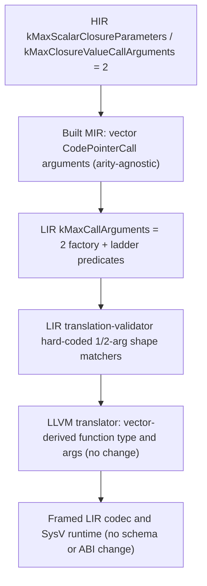

# RFC 0059: Scalar Closure And Call Ladder Arity Beyond Two

## Summary

Non-capturing Copy-only scalar closures are currently capped at two declared
parameters, and every call terminator is capped at two arguments. These are not
independent limits: the HIR closure cap is deliberately mirrored to the LIR call
ladder cap. This RFC proposes widening that scalar arity in one coordinated
cross-layer change, lifting the HIR, LIR, and validation boundaries together so
a three-parameter (and, up to an explicit bound, wider) non-capturing scalar
closure can lower end to end and execute natively on Linux x86-64. No new LIR
operation, codec tag, value carrier, calling convention, or runtime surface is
introduced; the work is widening representational bounds and generalizing
hard-coded arity shape matchers over representations that already store
arguments as length-framed vectors.

## Motivation

The closure narrowing track (RFC 0057 and the non-capturing parts of RFC 0058)
has exhausted every HIR-only count and parameter-key slice. The simple closure
arms now cover one or two parameters, an identifier naming either declared
parameter, and repeated operands, across bare references, arithmetic,
parameter-plus-literal, and unary bodies in both expression-body and
block-body spellings. The next shape users ask for is a closure that takes
three or more scalar parameters, for example:

```zom
fn entry() -> i32 {
  let f = (a: i32, b: i32, c: i32) -> i32 => a + b + c;
  let g = f;
  return g(1, 2, 3);
}
```

Today this fail-closes with one clean `ZOM4099` and zero incidents. The
producer comment at `compiler/hir/build/hir-builder.cc:13883` states the reason
directly: the closure parameter count is bounded by the scalar call ladder
width `lir::kMaxCallArguments`. The HIR gate cannot be widened in isolation
because the layers below reject the wider call, so progress requires a single
coordinated change owned by the LIR/call-ladder area rather than another
closure-builder predicate.

## Goals

- Define one explicit, named scalar arity bound that replaces the current value
  of two across the HIR closure admission gates and the LIR call ladder.
- Let a non-capturing scalar closure with up to the new bound of declared
  parameters lower through HIR, Built MIR, LIR, LLVM, object emission, linking,
  and `zomc run` on Linux x86-64, in both expression-body lambda and block-body
  function-expression spellings.
- Generalize the LIR translation-validator shape matchers that hard-code one
  and two arguments so correspondence and carrier validation hold for every
  admitted width, while preserving byte-identical validation for existing
  zero-, one-, and two-argument modules.
- Keep every over-bound shape, receiver/raising/ABI-declared closure, and all
  capturing-closure behavior on their existing fail-closed paths.

## Non-Goals

- No change to capture representation, the environment parameter, or the
  RFC 0058 capture boundary. This RFC is strictly about non-capturing scalar
  closure and call arity.
- No new value carrier: only the admitted integer scalar carriers are in scope.
  Boolean-carrier, float-ABI, aggregate-by-value, and reference/move parameter
  widening stay on their own tracks.
- No varargs, no function-typed parameters, and no generic-closure dispatch.
- No change to the platform calling convention, the runtime entry object, or
  any target other than Linux x86-64.
- No unbounded arity. The bound stays an explicit compile-time constant chosen
  inside the register-resident scalar range, not an open-ended vector.

## Prior Art

The codebase already proves that the lower layers are arity-agnostic once a
value crosses the cap.

- `MirCodePointerCallTerminator` (`compiler/mir/built-mir.h:652`) stores
  `zc::Vector<MirOperand> arguments`; the MIR representation has no fixed arity.
- The LIR algebra codec encodes sequences with `EncodeFramedSequence`, a
  big-endian element count followed by elements
  (`compiler/lir/lir-algebra-codec.h:98`). Argument count is part of the framed
  payload rather than a fixed-width schema field, so admitting more elements
  does not change a tag or the encoding of any existing module.
- The LLVM translator builds the indirect-call function type and argument list
  by looping over the terminator carriers and arguments
  (`compiler/backend/llvm/llvm-translator.cc:768-780`). It derives the LLVM
  function type from the carriers rather than a hard-coded prototype.
- The SysV x86-64 calling convention passes the first six integer arguments in
  registers. A modest scalar bound stays register-resident, and the bundled
  `runtime/entry-linux-x86_64.S` bootstrap imposes no argument-count assumption
  because closures lower to ordinary platform functions.

The precedent for a coordinated cap raise already exists in the multi-argument
direct-call work described in `docs/design/ir/lowerable-constructs.md`, which
lifted an earlier single-argument ceiling for same-module direct calls through
the same ladder.

## Guide-Level Explanation

For a user, the change makes the number of scalar parameters a closure can
take match the number of scalar arguments a call can carry, up to one documented
limit instead of two. Programs that currently fail to compile with a capability
diagnostic begin to compile and run when they stay within that limit; programs
over the limit, or programs that still rely on an unsupported carrier, keep the
same single diagnostic and never produce an internal compiler error.

For a compiler contributor, the limit is enforced in two places that must move
together: an HIR admission constant that decides whether a closure body is
lowered at all, and an LIR terminator constant that decides whether a call can
even be represented. The representations between and below them already hold
variable-length argument vectors, so the implementation is a bound change plus
validator generalization rather than a new data path.



## Reference-Level Design

### Current enforced boundary

The cap is enforced at the following measured sites.

- HIR builder: `kMaxScalarClosureParameters = 2` at
  `compiler/hir/build/hir-builder.cc:13886`, with the over-cap rejection at
  `:13890`, and the separate call-argument constant
  `kMaxClosureValueCallArguments = 2` at `:1007`.
- HIR verifier: the mirrored `kMaxScalarClosureParameters = 2` at
  `compiler/hir/hir-module.cc:1241`, its use at `:1244`, the published-count
  check at `:3100`, and `kMaxClosureValueCallArguments = 2` at `:15514`.
- LIR representation: `inline constexpr uint32_t kMaxCallArguments = 2` at
  `compiler/lir/lir-module.h:143`, enforced by the `callFunction`,
  `callVoidFunction`, and `indirectCall` terminator factories in
  `compiler/lir/lir-module.cc:193,209,223`.
- LIR lowering ladder: arity predicates in `compiler/lir/mir-to-lir.cc` at
  `:5664`, `:5766`, `:7326`, `:7948`, `:8216`, and `:8326`, with matching
  contracts documented in `compiler/lir/mir-to-lir.h:590,691,815`.
- Translation validation: hard-coded width matchers such as
  `voidCall.arguments.size() == 2` and
  `valueCall.arguments.size() == 1` at
  `compiler/lir/verify/translation-validator.cc:1017,1040`. The cross-edge
  correspondence loops at `:2843`, `:2875`, and `:2916` already iterate over
  the argument vector and need no structural change.

### Why a Copy-only HIR change cannot cover it

The HIR constant is not an independent policy; it is a mirror of the LIR cap.
Widening only the HIR gate would let the builder emit a closure with three
declared parameters. Built MIR would represent the call because its terminator
already holds a vector, but the LIR `indirectCall` and call factories return
`zc::none` for any argument vector longer than two. The module would then fail
at MIR to LIR lowering with the existing backend-slice rejection instead of
reaching native execution, and any predicate that mismatched an LIR invariant
would surface as a verifier rejection. There is no HIR-only surface that can
make a wider call representable, which is exactly why this is a shared change.

### Proposed coordinated change

1. Introduce the new scalar width as named constants in the HIR and LIR areas
   and keep their equality explicit in comments and tests. The first increment
   is a bound of three to unblock the motivating shape, structured so a later
   raise to the register-resident maximum is a constant change rather than a
   redesign.
2. Replace the hard-coded one/two-argument shape matchers in the translation
   validator with bounded predicates over the argument vector that assert
   count, carrier, destination, and edge correspondence for every width up to
   the cap. The existing loops already prove per-argument correspondence; the
   generalization covers the count and prototype match.
3. Widen the LIR ladder predicates that currently constrain `P` to
   `1..kMaxCallArguments` only by raising the bound they compare against,
   retaining every other shape condition.
4. Raise the two HIR closure constants in lockstep and admit the wider
   non-capturing scalar closure through the existing parameter arms, which
   already resolve operands independently per published parameter.
5. Leave the LIR terminator representation, the algebra codec, the LLVM
   translator, and the runtime untouched.

### Bitwise and consistency properties

Because the codec is length-framed and LLVM types are vector-derived, an
already-recorded zero-, one-, or two-argument module encodes and translates
byte-for-byte unchanged. The only new byte sequences are wider modules that
were previously unrepresentable. No canonical hash of an existing artifact is
expected to change, and the corpus parity channels must confirm this by showing
only added or newly admitted keys with every retained key unchanged.

## Repository Impact

| Area | Paths | Owner |
|---|---|---|
| LIR call representation and ladder | `compiler/lir/lir-module.h` (`kMaxCallArguments`), `compiler/lir/lir-module.cc` terminator factories, `compiler/lir/mir-to-lir.{h,cc}` arity predicates | `ir-backend` |
| HIR admission mirror | `compiler/hir/build/hir-builder.cc` and `compiler/hir/hir-module.cc` closure parameter and call-argument constants and predicates | `ir-backend` |
| Independent validation | `compiler/lir/verify/translation-validator.cc` bounded arity shape matchers; LIR structural verifier carrier and edge checks | `verification` |
| Conformance and native gates | new three-parameter closure corpus fixtures with AST/grammar/diagnostics expectations, native integration packages, session and LIR ztests, corpus parity snapshots | `verification` |
| RFC process | this RFC and the RFC 0057/0058 tracker relationship | `rfc` |

## Security And Safety Impact

No new trust boundary or unsafe construct is introduced. All admitted
parameters remain by-value Copy scalars passed through the existing typed LIR
carriers and the platform calling convention. The independent LIR verifier
continues to validate every emitted call; widening a matcher without
strengthening the per-argument correspondence would be rejected in review and
caught by the validator and the native gates. The explicit constant keeps
register-resident scalar arity bounded, so stack-argument lowering and its
additional safety analysis are deliberately deferred rather than accidentally
enabled. Over-bound and unsupported-carrier programs keep failing closed with
the existing capability diagnostic.

## Drawbacks And Risks

- Validator generalization is the highest-risk step. A matcher rewritten to a
  loop could silently weaken a count or carrier check. Mitigation: keep the
  exact existing assertions for widths zero through two, add the wider-width
  assertions alongside them, and require the old LIR oracle suites to pass
  unchanged.
- Two constants in two areas must stay equal. A drift where HIR admits a width
  the LIR cap rejects would recreate a fail-closed seam. Mitigation: a
  cross-layer ztest that asserts the HIR closure bound does not exceed the LIR
  call bound, and comments at both constants referencing each other.
- Register pressure grows with width. Staying within the SysV integer register
  set avoids stack-argument codegen; choosing a bound beyond it would require
  work this RFC explicitly excludes.
- The same `kMaxCallArguments` also bounds direct calls and aggregate field
  flattening. Raising it widens those surfaces too, so their existing tests
  must be re-run even though their behavior at widths up to two is unchanged.

## Alternatives Considered

- Keep the cap at two and special-case a third closure parameter with a new
  dedicated LIR terminator. Rejected: it adds an operation and codec tag to
  describe something the vector representation already encodes, multiplying
  the validator and translator surface for one extra slot.
- Remove the cap entirely. Rejected: it would admit stack-argument lowering and
  unbounded prototypes without the corresponding ABI and safety analysis, and
  it breaks the explicit fail-closed design of the terminator factories.
- Widen HIR first and handle the LIR rejection later. Rejected as explained in
  the design section: it cannot produce a runnable program and risks turning a
  clean capability drain into a lower-layer invariant failure.

## Compatibility And Rollout

Source compatibility is preserved: no existing admitted program changes
meaning, and previously rejecting programs either start compiling when within
the new bound or keep the identical diagnostic above it. The rollout is staged
so each layer is verifiable before the next opens. Rollback is a single
revert of the coordinated constant and predicate change set; because no codec
tag, carrier, or ABI surface changes, reverting restores the exact prior
rejection behavior with no data migration or artifact invalidation.

## Documentation And Teaching Plan

- Update `docs/design/ir/lir.md` and `docs/design/ir/lowerable-constructs.md`
  to state the new scalar call/closure width and mark the three-parameter
  closure as an admitted end-to-end construct with its native package.
- Record the milestone on the RFC 0057 closure tracker and note on the RFC 0058
  tracker that the shared call-ladder cap now also governs future capture width.
- Keep the spec grammar unchanged because parameter count is a lowering
  capability, not a grammar rule; grammar expectations continue to mark wider
  sources as parsing legally while semantic admission decides the rest.

## Operational Readiness

- The full sanitizer preset (`ASan` plus `UBSan` plus LeakSanitizer) must stay
  green, including the LIR translation validator and LLVM translation suites.
- `run-repo-lint.sh`, the format gate, and the English-only content gate must
  pass with no generated-file drift.
- Both corpus parity channels must show only added or newly admitted keys and
  zero changes to retained keys, evidencing the bitwise-stability claim.
- Native execution evidence is required through `native-run-cli` and
  `object-emission-cli` on Linux x86-64; cross-target rejection remains
  unchanged.

## Acceptance Criteria

- A non-capturing three-parameter scalar closure in both expression-body and
  block-body spellings compiles, links, and returns the correct native exit
  code through a whole-local copy chain, with zero diagnostics and zero
  incidents.
- A closure over the new bound, a receiver/raising/ABI-declared closure, and a
  capturing closure outside the existing flags each retain one clean `ZOM4099`
  with no internal compiler error.
- The HIR closure bound is provably no wider than the LIR call bound, and every
  admitted call up to that bound passes the independent LIR verifier.
- Existing zero-, one-, and two-argument LIR modules, object bytes, and parity
  hashes are unchanged.
- `python3 scripts/check-rfc.py` and the complete sanitizer and repo-lint gates
  pass.

## Implementation Plan

1. Land failing RED tests and native fixtures for the three-parameter closure
   and an over-bound rejection, with no production change.
2. Raise `kMaxCallArguments` and the LIR ladder predicates, then generalize the
   translation-validator arity matchers while preserving the existing width
   assertions; keep LLVM, codec, and runtime untouched.
3. Add a cross-layer bound-equality ztest, then raise the two HIR closure
   constants in lockstep and admit the wider non-capturing scalar closure.
4. Add the conformance four-way fixtures, native packages, ztests, and parity
   snapshots, then run the full gate set and update the design notes.

## Test Plan

- LIR ztests covering argument widths zero through the new bound and an
  over-cap factory rejection, asserting the terminator factory refuses the
  over-cap vector.
- Translation-validator ztests for the generalized count, carrier, and edge
  correspondence at each width, plus unchanged golden output for the existing
  widths.
- Compiler-session ztests asserting the three-parameter closure publishes the
  expected parameter count, one parameter reference per use, and a matching
  argument count, with HIR and MIR function inventory counts pinned.
- Native integration packages registered on `native-run-cli` and
  `object-emission-cli` asserting the linked executable exit code, plus a
  four-way conformance negative locking the over-bound drain.
- Full `ctest --preset default`, `run-repo-lint.sh`, format, English-only, and
  both corpus parity channels.

## Open Questions

None

## Status History

| Date | Status | Note |
|---|---|---|
| 2026-11-11 | DRAFT | Initial design proposal for coordinated scalar closure and call-ladder arity beyond two; no production code changed. |
| 2026-11-11 | REVIEW | Entered independent technical gate review. |
| 2026-11-11 | ACCEPTED | Technical gate approved; bound increment limited to three, aggregate flattening keeps the shared cap, float carrier width deferred. Local implementation authorized, no push or merge. |
| 2026-11-11 | IMPLEMENTING | Milestone 1 landed locally: the three-parameter bare parameter-reference closure lowers and runs natively; arithmetic, parameter-plus-literal, and unary three-parameter body arms remain on the ZOM4099 drain. See the implementation tracker for the root-cause correction and parity evidence. |
